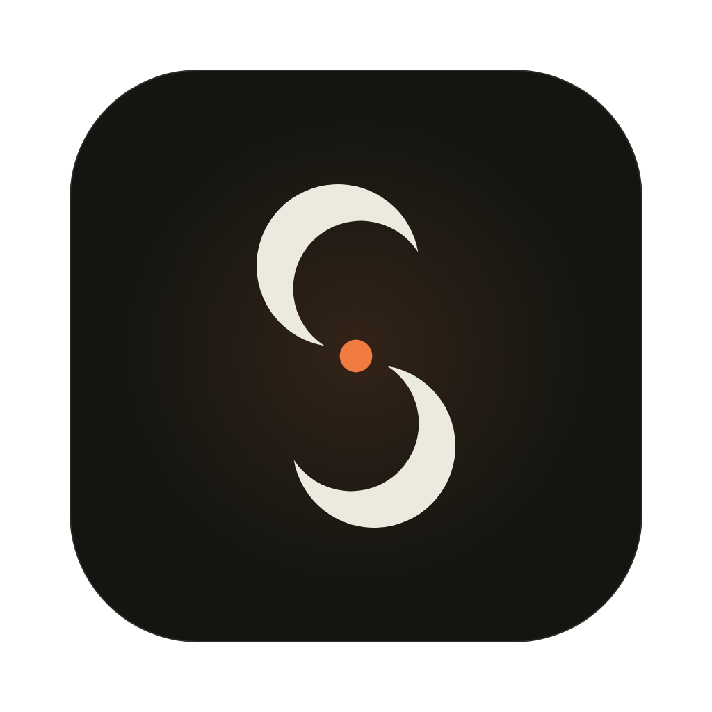

<div align="center">



# Sinapsi

[English](README.md) · **Italiano**

**Un'app di studio per macOS che trasforma le tue note di Obsidian in ripasso attivo, pratica socratica e un piano verso l'esame.**

Electron · React 19 · TypeScript · FSRS-5 · OpenRouter API · macOS

</div>

---

## Che cos'è

Rileggere gli appunti dà una sensazione illusoria di familiarità che svanisce davanti a un esercizio nuovo. Sinapsi parte dalle note Markdown che hai già scritto nel tuo vault Obsidian e ti fa lavorare attivamente con esse: ti chiede di richiamare alla mente invece di limitarti a riconoscere, ti guida con domande socratiche invece di darti la soluzione pronta e programma i ripassi spaziati esattamente quando stai per dimenticare.

Tre principi fondamentali reggono tutta l'applicazione:

- **Il vault è rigorosamente in sola lettura.** Sinapsi non scrive e non modifica mai i file del tuo vault Obsidian. Tutto ciò che genera risiede nella cartella dati locale dell'applicazione.
- **Prima il tentativo, poi l'aiuto.** Il tutor non regala mai la soluzione: gli indizi si sbloccano uno scalino alla volta, e solo dopo che hai documentato un tentativo.
- **La padronanza si misura, non si dichiara.** La ritenzione della memoria è calcolata tramite l'algoritmo matematico FSRS-5 in base alle tue risposte reali negli esercizi, non tramite caselle spuntate a mano.

---

## Privacy e sicurezza

- **Backend AI OpenRouter:** Tutte le funzionalità intelligenti (estrazione dei concetti, generazione delle note vive, tutor socratico, correzione degli esercizi, trascrizione ottica OCR) utilizzano l'API HTTP di OpenRouter (`https://openrouter.ai/api/v1`).
- **Trasmissione dei dati:** Quando utilizzi una funzione AI, gli estratti pertinenti delle note e le tue risposte di studio vengono inviati in modo sicuro tramite HTTPS a OpenRouter e al fornitore del modello selezionato (ad es. Anthropic o Google).
- **Archiviazione sicura della chiave:** La chiave API di OpenRouter viene cifrata e memorizzata nel Portachiavi di macOS tramite Electron `safeStorage`. Il processo renderer è isolato e non riceve né memorizza mai la chiave API (riceve solo un booleano `{ hasKey: boolean }`).
- **Nessuna telemetria:** Sinapsi non raccoglie dati personali, metriche o telemetria.

---

## Funzionalità

### Oggi, Mappa, Piano

- **Oggi:** Dashboard operativa con suggerimenti di studio intelligenti, ripassi FSRS in scadenza, lezioni da rielaborare e prontezza per il prossimo esame.
- **Mappa:** Grafo interattivo orientato dei concetti atomici e delle catene deduttive ($\text{premesse} \implies \text{conclusione}$). Colorato per stato di memoria e filtrabile per concetti in scadenza, fragili o mai studiati.
- **Piano:** Pianificatore degli esami con date, ore di studio previste e indice di prontezza calcolato in tempo reale.
- **Materie nella barra laterale:** Rilevate automaticamente dalle cartelle di primo livello del vault, organizzate nelle categorie Universitarie e Personali con ordinamento personalizzabile tramite trascinamento.

### Sessioni di studio socratico

Dialogo interattivo in cui il tutor sonda la tua conoscenza delle basi, costruisce una mappa di apprendimento minima e ti guida attraverso cicli di previsione, spiegazione e verifica, arricchiti da minigiochi (Lampo, Coppie, Ricomponi, Trova l'intruso, Tabù).

### Note vive

Trasforma una nota di Obsidian in una dispensa interattiva a blocchi validati:
- Definizioni e teoremi atomizzati.
- Decodifica su tre livelli: formula formale, lettura in linguaggio naturale e intuizione geometrica.
- Dimostrazioni passo per passo nascoste, consultabili solo dopo aver provato a ragionarci.
- Figure SVG interattive con cursori e punti trascinabili.
- Formule matematiche in KaTeX e diagrammi in Mermaid.

### Ripasso spaziato (FSRS-5)

Ripasso spaziato a livello di singolo concetto gestito da `ts-fsrs` con decadimento continuo a tempo frazionario. Molteplici formati di verifica:
- Risposte aperte, scelte multiple, vero/falso con motivazione.
- Riordino logico dei passaggi di una dimostrazione.
- Completamento (cloze), abbinamento, controesempi e stime.
- *«Spiegalo tu»* (spiegazione orale o scritta a libro chiuso valutata da un compagno di corso rigoroso e pignolo).
- Calibrazione metacognitiva della fiducia (risposta sbagliata con alta fiducia segnala una possibile misconcezione).

### Pratica e simulazione d'esame

- **Allenamento:** Esercizi mirati con una scala di 6 indizi che si sblocca progressivamente.
- **Simulazione d'esame:** Prove cronometrate senza aiuti con valutazione in trentesimi.
- **Esame su carta:** Risolvi i problemi su carta fisica, scatta una foto con la fotocamera del Mac o con Continuity Camera dell'iPhone, e lascia che il modello visivo trascriva testo e formule LaTeX per la correzione.

---

## Requisiti

- **Sistema operativo:** macOS 13 (Ventura) o successivo (consigliato Apple Silicon).
- **Runtime:** Node.js 20 o superiore.
- **Accesso AI:** Un account attivo su [OpenRouter](https://openrouter.ai/) e una chiave API.
- **Strumenti facoltativi:**
  - Python 3 con `mlx_whisper` su Apple Silicon per la dettatura vocale locale (`pip install mlx-whisper`).
  - `yt-dlp` e `ffmpeg` per trascrivere fonti video e audio nei notebook.

---

## Guida all'avvio

### 1. Clonazione e installazione

```bash
git clone https://github.com/andrevvuuuu/sinapsi.git
cd sinapsi
npm install
```

### 2. Configurazione del Vault e della chiave OpenRouter

Avvia l'applicazione in modalità sviluppo:

```bash
npm run dev
```

1. **Scegli il tuo Vault:** Al primo avvio, apri il pannello destro ("Note di Obsidian") e fai clic su **Scegli cartella del vault** per selezionare la cartella del tuo vault Obsidian. Sinapsi indicizzerà le note in sola lettura e scoprirà le materie.
2. **Configura OpenRouter:** Apri le Impostazioni (icona ingranaggio in basso a sinistra), vai nella sezione **OpenRouter**, incolla la tua chiave API e premi **Salva**. Puoi testare la connessione con **Verifica chiave**.

### Risoluzione della chiave in sviluppo

Per lo sviluppo e i test automatizzati, la chiave viene risolta con questo ordine di priorità:
1. Chiave cifrata in Electron `safeStorage` (impostata tramite la finestra Impostazioni).
2. Variabile d'ambiente: `export OPENROUTER_API_KEY="<tua-chiave-api>"`.
3. File locale `secret-api.txt` nella radice del repository (funziona solo in locale con build non impacchettate; escluso automaticamente dalle distribuzioni di produzione).

---

## Modelli consigliati

Puoi personalizzare il modello per ogni specifico compito in **Impostazioni → OpenRouter**:

| Compito | Modello predefinito | Descrizione |
| :--- | :--- | :--- |
| **Estrazione concetti** (`extract`) | `google/gemini-2.5-flash` | Estrazione veloce di concetti e catene deduttive |
| **Note vive** (`note`) | `google/gemini-2.5-flash` | Generazione strutturata di dispense interattive |
| **Varianti di ripasso** (`variants`) | `google/gemini-2.5-flash` | Generazione veloce di varianti di verifica |
| **Tutor e compiti** (`teach`) | `anthropic/claude-sonnet-5.5` | Dialogo e sessioni di studio socratico |
| **Correzione risposte** (`grade`) | `anthropic/claude-sonnet-5.5` | Valutazione rigorosa delle risposte aperte |
| **Lettura foto** (`photo`) | `google/gemini-2.5-flash` | OCR visivo per compiti scritti a mano e formule |

*Nota: Se il tuo workspace OpenRouter ha restrizioni sui modelli Google, `anthropic/claude-haiku-5.5` è l'alternativa consigliata per i compiti flash.*

---

## Creazione dei pacchetti

```bash
# Compilazione applicazione senza installer (dist/mac-arm64/Sinapsi.app)
npm run build:unpack

# Creazione DMG distribuibile
npm run dist
```

*Nota: Trattandosi di una build non firmata, al primo avvio su macOS fai clic destro sull'app nel Finder e seleziona **Apri**.*

---

## Sviluppo e test

```bash
# Esegui test unitari e di integrazione (Vitest)
npm test

# Controllo tipi TypeScript (main e renderer)
npm run typecheck

# Linting del codice (ESLint)
npm run lint

# Smoke test live con OpenRouter (richiede OPENROUTER_API_KEY o secret-api.txt)
npx tsx scripts/openrouter-smoke.ts

# Test end-to-end (Playwright)
npm run test:e2e
```

### Variabili d'ambiente

| Variabile | Descrizione |
| :--- | :--- |
| `OPENROUTER_API_KEY` | Chiave API OpenRouter per le richieste in sviluppo |
| `SINAPSI_DATA` | Percorso cartella dati personalizzata (default: `~/Library/Application Support/Sinapsi`) |
| `SINAPSI_VAULT` | Percorso cartella vault personalizzata |
| `SINAPSI_FAKE_EXTRACT` | Con `1`, usa risposte deterministiche simulate per l'estrazione concetti |
| `SINAPSI_FAKE_NOTE` | Con `1`, usa risposte simulate per la generazione delle note vive |
| `SINAPSI_FAKE_REVIEW` | Con `1`, usa risposte simulate per le domande di ripasso |
| `SINAPSI_FAKE_TEACHER` | Con `1`, usa risposte simulate per il tutor di studio |
| `SINAPSI_FAKE_PRACTICE`| Con `1`, usa risposte simulate per il tutor della pratica |
| `SINAPSI_FAKE_MEDIA` | Con `1`, simula le chiamate a whisper/trascrizione locale |

---

## Documentazione

- [`docs/ARCHITECTURE.md`](docs/ARCHITECTURE.md): Architettura di sistema e flussi di dati
- [`docs/MIGRATION_AUDIT.md`](docs/MIGRATION_AUDIT.md): Audit di migrazione al backend OpenRouter
- [`docs/design.md`](docs/design.md): Progetto funzionale originale
- [`docs/ricerca/il-mio-metodo.md`](docs/ricerca/il-mio-metodo.md): Metodologia didattica di studio attivo
- [`CONTRIBUTING.md`](CONTRIBUTING.md): Convenzioni di sviluppo e linee guida per le pull request
- [`SECURITY.md`](SECURITY.md): Politiche di sicurezza e segnalazione vulnerabilità

---

## Licenza

Licenza ISC. Consulta i metadati del repository per maggiori informazioni.
