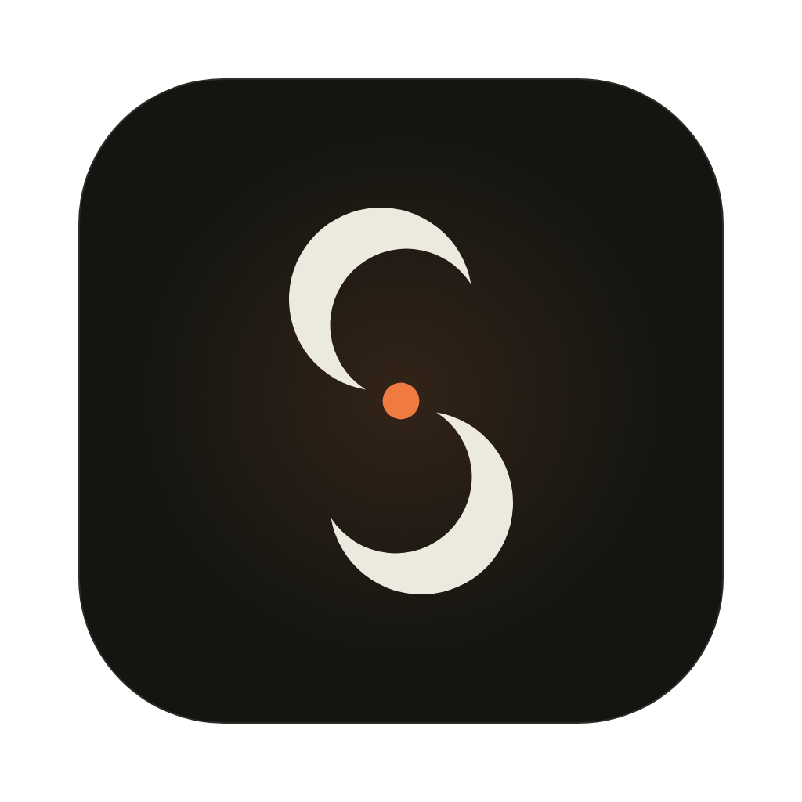

<div align="center">



# Sinapsi

**English** · [Italiano](README.it.md)

**A macOS study app that turns your Obsidian notes into active recall, Socratic practice and an exam plan.**

Electron · React 19 · TypeScript · FSRS-5 · OpenRouter API · macOS

</div>

> The app's user interface is in Italian. The code, comments, and documentation are in English.

---

## What it is

Rereading notes creates an illusion of competence that vanishes when facing an unfamiliar problem. Sinapsi starts from the Markdown notes you already keep in your Obsidian vault and forces active engagement: it asks you to recall rather than recognize, guides you with Socratic questions rather than revealing solutions, and schedules spaced repetitions right before you forget.

Three core principles govern the application:

- **The vault is strictly read-only.** Sinapsi never modifies or writes to your Obsidian vault. Everything it generates lives in its own local application data folder.
- **Attempt first, help second.** The tutor never hands over solutions: hints unlock one rung at a time, and only after you have attempted to answer.
- **Mastery is measured, not declared.** Concept retention is modeled mathematically using FSRS-5 based on your actual practice answers, not self-selected checkboxes.

---

## Privacy & Security

- **OpenRouter API:** All AI interactions (concept extraction, living note generation, Socratic tutoring, grading, and handwriting OCR) use the OpenRouter HTTP API (`https://openrouter.ai/api/v1`).
- **Data Transmission:** When you interact with AI features, relevant note excerpts and your study responses are transmitted securely over HTTPS to OpenRouter and the chosen upstream model provider (e.g. Anthropic, Google).
- **Secure Key Storage:** Your OpenRouter API key is encrypted and stored locally in the macOS Keychain using Electron's `safeStorage`. The renderer process is sandboxed and never receives or stores your API key (it only receives `{ hasKey: boolean }`).
- **No Telemetry / No Tracking:** Sinapsi does not collect personal analytics, telemetry, or user data.

---

## Features

### Today, Map, Plan (Oggi, Mappa, Piano)

- **Oggi (Today):** Actionable dashboard with smart study suggestions, due FSRS reviews, pending lesson digestion, and exam countdowns.
- **Mappa (Map):** Interactive directed graph of atomic concepts and deduction chains ($\text{premises} \implies \text{conclusion}$). Filter by memory status (due, fragile, never seen).
- **Piano (Plan):** Exam planner with dates, target hours, and real-time readiness scores.
- **Sidebar Subjects:** Discovered automatically from the top-level folders of your vault, organized into University and Personal categories with custom drag-and-drop ordering.

### Socratic Study Sessions

Interactive dialogue where the tutor probes your prerequisite knowledge, maps out a learning trajectory, and leads you through predict-explain-verify cycles with mini-games (Lampo, Coppie, Ricomponi, Trova l'intruso, Tabù).

### Living Notes (Note vive)

Transforms a raw Obsidian note into an interactive study handout:
- Atomized definitions and theorems.
- Three-level explanations: formal notation, plain language, and geometric intuition.
- Hidden step-by-step proofs revealed only after an attempt.
- Interactive SVG figures with sliders and draggable elements.
- Formula rendering with KaTeX and diagram rendering with Mermaid.

### Spaced Repetition (FSRS-5)

Concept-level spaced repetition powered by `ts-fsrs` with continuous fractional-day decay. Multiple question formats:
- Open-ended recall, multiple choice, true/false with justification.
- Proof and derivation step reordering.
- Cloze, matching, counterexamples, and estimation.
- *"Spiegalo tu"* (closed-book oral or written explanation evaluated by a picky peer persona).
- Metacognitive confidence calibration (high confidence + wrong answer flags misconceptions).

### Practice & Exam Simulation

- **Training:** Targeted problems with a 6-rung hint ladder that unlocks progressively.
- **Exam Simulation:** Timed exams with grading out of 30.
- **Paper Exam Mode:** Solve problems on physical paper, snap a photo via iPhone Continuity Camera or webcam, and let the vision model transcribe text and LaTeX formulas for automated grading.

---

## Requirements

- **Operating System:** macOS 13 (Ventura) or later (Apple Silicon recommended).
- **Runtime:** Node.js 20 or later.
- **AI Backend:** An active [OpenRouter](https://openrouter.ai/) account and API key.
- **Optional Tools:**
  - Python 3 with `mlx_whisper` on Apple Silicon for local voice dictation (`pip install mlx-whisper`).
  - `yt-dlp` and `ffmpeg` for transcribing video and audio sources into notebooks.

---

## Getting Started

### 1. Clone & Install

```bash
git clone https://github.com/andrevvuuuu/sinapsi.git
cd sinapsi
npm install
```

### 2. Configure Your Vault & OpenRouter Key

Run the development server:

```bash
npm run dev
```

1. **Pick your Vault:** On first launch, open the right-hand panel ("Note di Obsidian") and click **Scegli cartella del vault** to select your Obsidian vault directory. Sinapsi scans your notes in read-only mode and discovers subjects from the folder structure.
2. **Configure OpenRouter:** Open Settings (the gear icon at bottom left), navigate to the **OpenRouter** section, paste your API key, and click **Salva**. You can test the connection with **Verifica chiave**.

### Development Key Resolution

For development and automation, the API key is resolved in the following order:
1. Key stored in Electron `safeStorage` (set via Settings dialog).
2. Environment variable: `export OPENROUTER_API_KEY="<your-api-key>"`.
3. Local file `secret-api.txt` at the repository root (only in unpackaged development builds; automatically excluded from production releases).

---

## Recommended Models

You can customize the model used for each specific task in **Impostazioni → OpenRouter**:

| Task | Default Model Slug | Description |
| :--- | :--- | :--- |
| **Estrazione concetti** (`extract`) | `google/gemini-2.5-flash` | Fast concept and deduction chain extraction |
| **Note vive** (`note`) | `google/gemini-2.5-flash` | Structured interactive note generation |
| **Varianti di ripasso** (`variants`) | `google/gemini-2.5-flash` | Fast generation of multiple review question formats |
| **Tutor e compiti** (`teach`) | `anthropic/claude-sonnet-5.5` | Socratic dialogue and teaching sessions |
| **Correzione risposte** (`grade`) | `anthropic/claude-sonnet-5.5` | Strict rubric-based answer evaluation |
| **Lettura foto** (`photo`) | `google/gemini-2.5-flash` | Vision OCR for handwritten paper exams and math |

*Note: If your OpenRouter workspace has provider restrictions on Google models, `anthropic/claude-haiku-5.5` is the recommended alternative for flash-class tasks.*

---

## Packaging

```bash
# Build unpacked application (dist/mac-arm64/Sinapsi.app)
npm run build:unpack

# Build distributable DMG
npm run dist
```

*Note: As an unsigned build on macOS, right-click the app in Finder and choose **Open** on initial launch.*

---

## Development & Testing

```bash
# Run unit and integration tests (Vitest)
npm test

# Typecheck TypeScript (main and renderer)
npm run typecheck

# Lint codebase (ESLint)
npm run lint

# Run live OpenRouter smoke test (requires OPENROUTER_API_KEY or secret-api.txt)
npx tsx scripts/openrouter-smoke.ts

# Run E2E tests (Playwright)
npm run test:e2e
```

### Environment Variables

| Variable | Description |
| :--- | :--- |
| `OPENROUTER_API_KEY` | OpenRouter API key for requests in development |
| `SINAPSI_DATA` | Custom data directory (defaults to `~/Library/Application Support/Sinapsi`) |
| `SINAPSI_VAULT` | Override vault directory path |
| `SINAPSI_FAKE_EXTRACT` | Set to `1` to use deterministic mock responses for concept extraction |
| `SINAPSI_FAKE_NOTE` | Set to `1` to use deterministic mock responses for living notes |
| `SINAPSI_FAKE_REVIEW` | Set to `1` to use deterministic mock responses for review questions |
| `SINAPSI_FAKE_TEACHER` | Set to `1` to use deterministic mock responses for study tutor |
| `SINAPSI_FAKE_PRACTICE`| Set to `1` to use deterministic mock responses for practice tutor |
| `SINAPSI_FAKE_MEDIA` | Set to `1` to mock local whisper/transcription calls |

---

## Documentation

- [`docs/ARCHITECTURE.md`](docs/ARCHITECTURE.md): System architecture and data flow (Italian)
- [`docs/MIGRATION_AUDIT.md`](docs/MIGRATION_AUDIT.md): Migration audit for the OpenRouter AI layer
- [`docs/design.md`](docs/design.md): Original functional specifications
- [`docs/ricerca/il-mio-metodo.md`](docs/ricerca/il-mio-metodo.md): Active recall methodology
- [`CONTRIBUTING.md`](CONTRIBUTING.md): Code conventions and contribution guidelines
- [`SECURITY.md`](SECURITY.md): Security and vulnerability reporting policies

---

## License

ISC License. See repository metadata for details.
