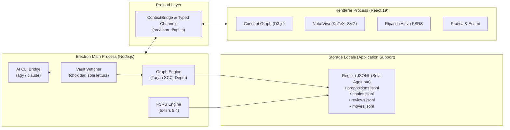

# Sinapsi

<div align="center">

**Sistema avanzato di studio attivo, apprendimento socratico e memorizzazione a lungo termine per macOS.**  
_Integra vault Obsidian in sola lettura, grafo deduttivo della conoscenza, note vive interattive, schedulazione FSRS-5 e intelligenza artificiale socratica ad abbonamento zero-API-key._

[](https://www.typescriptlang.org/)
[](https://www.electronjs.org/)
[](https://react.dev/)
[](https://github.com/open-spaced-repetition/ts-fsrs)
[](https://vitest.dev/)
[](<>)

</div>

---

## Indice

- [Panoramica e Filosofia Cognitiva](#panoramica-e-filosofia-cognitiva)
- [Architettura ad Alto Livello](#architettura-ad-alto-livello)
- [Funzionalità Chiave](#funzionalità-chiave)
  - [1. Integrazione Vault Obsidian (Sola Lettura)](#1-integrazione-vault-obsidian-sola-lettura)
  - [2. Grafo Deduttivo dei Concetti (Concept Graph)](#2-grafo-deduttivo-dei-concetti-concept-graph)
  - [3. Note Vive Interattive & Parametric Canvas](#3-note-vive-interattive--parametric-canvas)
  - [4. Ripasso Attivo e Algoritmo FSRS-5](#4-ripasso-attivo-e-algoritmo-fsrs-5)
  - [5. Notebook Grounded RAG (Anti-Allucinazione)](#5-notebook-grounded-rag-anti-allucinazione)
  - [6. Pratica Socratica & Simulazione d'Esame](#6-pratica-socratica--simulazione-desame)
  - [7. Dettatura Vocale Locale (Apple Silicon)](#7-dettatura-vocale-locale-apple-silicon)
- [Stack Tecnologico](#stack-tecnologico)
- [Requisiti e Configurazione](#requisiti-e-configurazione)
  - [Configurazione Motori AI (Zero API Keys)](#configurazione-motori-ai-zero-api-keys)
  - [Variabili d'Ambiente](#variabili-dambiente)
- [Guida Rapida (Quickstart)](#guida-rapida-quickstart)
- [Test & Qualità del Codice](#test--qualità-del-codice)
- [Guida per i Contributori](#guida-per-i-contributori)
- [Documentazione Aggiuntiva](#documentazione-aggiuntiva)

---

## Panoramica e Filosofia Cognitiva

La maggior parte degli studenti e dei ricercatori sperimenta la cosiddetta **illusione di competenza**: rileggere passivamente un testo evidenziato o un set di appunti crea una sensazione di familiarità che svanisce completamente nel momento in cui è necessario risolvere un problema inedito o ricostruire una dimostrazione matematica complessa.

**Sinapsi** è un'applicazione desktop per macOS nata per automatizzare le migliori pratiche della scienza dell'apprendimento (_Learn Harness_):

1. **Evocazione Attiva (Active Recall):** L'app non interroga mai con compiti di mero riconoscimento visivo passivo, ma richiede l'estrazione attiva di definizioni, passaggi logici e controesempi dalla memoria.
2. **Spaced Repetition di Nuova Generazione (FSRS-5):** Supera il classico algoritmo SM-2 (usato in Anki) calcolando dinamicamente stabilità della memoria, difficoltà intrinseca e curva di ritenzione con tempo frazionario continuo.
3. **Catene di Ragionamento Deduttive:** La conoscenza non è una sequenza di flashcard isolate. Sinapsi modella ogni concetto come un'asserzione atomica inserita in una rete di implicazioni ($\text{Premesse} \implies \text{Conclusione}$), calcolando la profondità di inferenza logica con algoritmi formali di teoria dei grafi.
4. **Scaffolding Socratico con Blocco Tentativo:** Il tutor AI non svela mai le soluzioni: guida passo-passo attraverso una scala graduata di indizi (da R0 a R5), sbloccando i livelli strategici solo a fronte di un tentativo documentato dello studente.
5. **Esclusività Rigorosa delle Fonti:** Le chat e le sintesi sono confinate esclusivamente ai documenti primari caricati (PDF accademici, slide, lezioni trascritte), impedendo allucinazioni o deviazioni dal programma di studio.

---

## Architettura ad Alto Livello

Sinapsi adotta un'architettura Electron modulare e sicura, governata dal principio dell'**Event Sourcing (Append-Only Ledgers)**:



> 📖 Per la specifica tecnica esaustiva, i dettagli dei moduli e i diagrammi di sequenza dettagliati, consulta la [Documentazione Architetturale (`docs/ARCHITECTURE.md`)](docs/ARCHITECTURE.md).

---

## Funzionalità Chiave

### 1. Integrazione Vault Obsidian (Sola Lettura)

- **Sicurezza assoluta dei tuoi appunti:** Sinapsi legge il tuo vault (predefinito in `~/Obsidian Vault`) e **non scrive né modifica mai alcun file markdown al suo interno**.
- **Sincronizzazione in tempo reale:** Monitoraggio tramite `chokidar`; le modifiche ai file aggiornano istantaneamente l'indice delle note e le catene logiche.
- **Ignora modifiche superficiali:** L'hashing SHA-256 del corpo della nota (`bodyHash`) isola il contenuto dal frontmatter, evitando rielaborazioni inutili se modifichi solo i metadati in Obsidian.
- **Segnalazioni Costruttive:** Se l'AI rileva un refuso o un errore logico nella tua nota, genera un blocco `flag` nella nota viva con il pulsante _"Copia correzione per Obsidian"_ negli appunti.

### 2. Grafo Deduttivo dei Concetti (Concept Graph)

- **Topologia Reale:** I nodi sono enunciati atomici estratti da Gemini; gli archi sono catene di deduzione formale ($\text{Premesse} \implies \text{Conclusione}$). Un concetto condiviso tra più corsi appare come un unico nodo.
- **Risoluzione dei Cicli con Algoritmo di Tarjan:** I cicli di dipendenza reciproca vengono identificati e collassati in componenti fortemente connesse (SCC) per calcolare la **Profondità di Inferenza (Inference Depth)** di ogni nodo a partire dagli assiomi base.
- **3 Proiezioni D3.js Hardware-Accelerate:**
  - **Radiale:** Assiomi e definizioni al centro, teoremi derivati verso la periferia su anelli concentrici.
  - **A Piani (Stratificato):** Fondamenta in basso, vette teoriche in alto.
  - **Libera:** Simulazione a forze molecolari con raggruppamento per note d'origine (`d3-polygon`).
- **Lenti Cognitive:** Filtra visivamente i concetti colorandoli per stato di memoria FSRS (Verde = Solido, Giallo = Incerto, Rosso = Debole, Tratteggiato = Mai visto, Cerchiata = Basi fragili).
- **Rilevamento della Frontiera:** Evidenzia i concetti citati nei MOC (_Maps of Content_) ma non ancora redatti nel vault.

### 3. Note Vive Interattive & Parametric Canvas

- **Dispense Dinamiche:** A partire dalla nota Obsidian e dalle fonti di riferimento, Gemini redige una "Nota Viva" strutturata in blocchi semantici rigorosi (validati tramite schema Zod `NotaSchema`):
  - **Teoremi e Definizioni:** Blocchi evidenziati con notazione standard.
  - **Decodifica a Tre Livelli:** Traduzione immediata tra _Formalismo matematico_, _Lettura in italiano_ e _Intuizione pratica_.
  - **Dimostrazioni a Passi:** Ogni passaggio logico si illumina durante la lettura e sincronizza lo stato della figura geometrica a lato.
  - **Figure Matematiche Parametriche SVG:** Grafici vettoriali con slider interattivi, punti trascinabili e condizioni visive che diventano verdi (`greenWhen`) quando il vincolo matematico è soddisfatto.
  - **Modalità "Prova da solo":** Copre lo svolgimento delle dimostrazioni e degli esercizi finché lo studente non ha formulato il proprio tentativo.

### 4. Ripasso Attivo e Algoritmo FSRS-5

- **Schedulazione Continua:** Implementazione FSRS-5 (`ts-fsrs`) con calcolo istantaneo della probabilità di ritenzione $R(t, S) = (1 + \frac{19}{81}\frac{t}{S})^{-0.5}$.
- **10 Tipologie di Varianti Generate dall'AI:** Il sistema prepara in background 4–5 angolazioni diverse per ogni concetto per evitare la mera memorizzazione visiva della domanda:
  1. Risposta aperta (correzione semantica da Claude)
  2. "Spiegalo tu" (tecnica di Feynman a turni)
  3. Scelta multipla con confutazione analitica dei distrattori
  4. Vero/Falso con giustificazione obbligatoria
  5. Riordino dei passaggi logici di una derivazione
  6. Testo a completamento con cloze LaTeX bilanciato
  7. Accoppiamento concettuale (ipotesi $\leftrightarrow$ tesi)
  8. Individuazione del controesempio confutante
  9. Stima quantitativa numerica con tolleranza
  10. "Trova l'errore" nella riga di calcolo
  11. Manipolazione del grafico fino al raggiungimento del target
- **Rilevamento Misconcezioni:** Errare una domanda avendo espresso una fiducia elevata ($\ge 70\%$) marca il concetto come "misconcezione" e predispone un modulo di ri-apprendimento immediato.

### 5. Notebook Grounded RAG (Anti-Allucinazione)

- **Ingestione Multimediale Locale:**
  - **PDF Accademici:** Estrazione testo pagina per pagina con rimozione intelligente di testate/piè di pagina e avviso di pagine scansionate senza testo.
  - **Presentazioni (.pptx):** Decompressione ed estrazione delle slide.
  - **YouTube:** Download audio con `yt-dlp` e acquisizione sottotitoli.
  - **Registrazioni e Video:** Trascrizione locale fulminea con `mlx_whisper` su Apple Silicon (zero quota cloud consumata).
- **Chat Confinata:** La risposta AI viene generata isolando il contesto nei tag `<estratto>`: ogni singola affermazione deve riportare l'indice numerico della fonte. Se le fonti non contengono la risposta, l'AI dichiara esplicitamente cosa manca nella sezione _"Le fonti non dicono"_.

### 6. Pratica Socratica & Simulazione d'Esame

- **Modalità Allenamento:** Esercizi a difficoltà progressiva senza annuncio del teorema risolutivo.
- **Scala di Indizi R0–R5:** Indizi a gradino crescente (Attenzione $\to$ Dominio $\to$ Strategia $\to$ Teorema $\to$ Primo passo $\to$ Soluzione). Gli indizi superiori a R0 si sbloccano solo dopo un tentativo inviato.
- **Simulazione d'Esame:** Compiti da 30 punti a tempo (30/60/90 min), salvataggio continuo, blocco aiuti e consegna automatica con calcolo del voto in trentesimi e soluzioni complete.
- **Continuity Camera & OCR Manoscritto:** Integrazione con l'iPhone per fotografare il foglio degli esercizi: Claude trascrive il testo e le formule in LaTeX per il controllo e la valutazione.

### 7. Dettatura Vocale Locale (Apple Silicon)

- Daemon Python persistente con `mlx_whisper` in background: permette di dettare risposte, ragionamenti o spiegazioni in qualsiasi campo testuale dell'app con accuratezza elevata in lingua italiana e zero latenza di avvio.

---

## Stack Tecnologico

| Componente                | Tecnologia / Libreria                               | Scopo Architetturale                                          |
| ------------------------- | --------------------------------------------------- | ------------------------------------------------------------- |
| **Piattaforma Desktop**   | Electron 44, Node.js                                | Container applicativo per macOS, gestione finestre e IPC      |
| **Frontend Framework**    | React 19, TypeScript 5.9                            | Componenti reattivi, interfaccia declarativa                  |
| **Design System**         | `@glass-sdk/liquid-glass`, `@base-ui/react`         | Materiale visivo Liquid Glass, componenti accessibili WCAG AA |
| **Bundler & Tooling**     | Electron-Vite 6, Vite 8                             | Build pipeline HMR ultra-rapida e bundling differenziato      |
| **Ripasso & Memoria**     | `ts-fsrs` 5.4.2                                     | Free Spaced Repetition Scheduler v5                           |
| **Grafo & Fisica**        | `d3-force`, `d3-zoom`, `d3-polygon`, `d3-selection` | Rendering topologico del grafo, calcolo regioni e zoom        |
| **Tipografia Matematica** | `katex` 0.19                                        | Rendering formule LaTeX ad altissima velocità                 |
| **Markdown & Diagrammi**  | `marked` 18, `mermaid` 12, `dompurify` 3.4          | Parsing markdown sicuro e diagrammi di flusso                 |
| **Parsing Documenti**     | `pdfjs-dist` 6.4, `fflate` 0.8.3, `gray-matter` 4   | Ingestione PDF, PPTX e frontmatter YAML                       |
| **File System Watching**  | `chokidar` 6.0                                      | Osservazione real-time dei file del Vault Obsidian            |
| **Validazione & Schemi**  | `zod` 4.6                                           | Contratti tipizzati runtime tra Main, Renderer e risposte AI  |
| **Testing**               | Vitest 3.2, Playwright 1.64                         | Test unitari completi e test end-to-end                       |

---

## Requisiti e Configurazione

### Requisiti di Sistema

- **Sistema Operativo:** macOS 13.0 (Ventura) o successivo (Apple Silicon M1/M2/M3/M4 consigliato, compatibile anche con Intel).
- **Node.js:** Versione 20.x o superiore e `npm`.

### Configurazione Motori AI (Zero API Keys)

Sinapsi sfrutta le utenze ad abbonamento già attive sul tuo Mac tramite CLI, **senza necessità di acquistare chiavi API a consumo**:

1. **Google Antigravity CLI (`agy`):** Utilizzata come motore principale per compiti ad alto throughput (estrazione concetti, sintesi note vive, varianti di domande, notebook RAG).
   - Verifica nel terminale: `agy --version`
   - Se compare "serve l'accesso": esegui `agy` nel terminale, completa l'autenticazione nel browser e riapri Sinapsi.
2. **Claude Code CLI (`claude`):** Utilizzata per il ragionamento socratico profondo, correzione aperta ed esami.
   - Verifica nel terminale: `claude --version`
   - Se non autenticato: esegui `claude` nel terminale ed effettua il login.
3. _(Facoltativo)_ **Media & Dettatura locale:**
   - `pip install mlx-whisper` (per la dettatura locale istantanea su Apple Silicon)
   - `yt-dlp` (per il caricamento di video e lezioni YouTube nei notebook)

### Variabili d'Ambiente

| Variabile         | Valore Predefinito                      | Descrizione                                                                    |
| ----------------- | --------------------------------------- | ------------------------------------------------------------------------------ |
| `SINAPSI_DATA`    | `~/Library/Application Support/Sinapsi` | Cartella di archiviazione dei ledgers, cache e sessioni                        |
| `SINAPSI_VAULT`   | `~/Obsidian Vault`                      | Percorso assoluto del Vault Obsidian da indicizzare (sovrascrive settings)     |
| `SINAPSI_FAKE_AI` | `0` (non attiva)                        | Se impostata a `1`, attiva mock deterministici offline per test di sviluppo    |
| `LIVE_AI`         | `0` (non attiva)                        | Se impostata a `1`, abilita chiamate reali ad `agy` e `claude` nei test Vitest |

---

## Guida Rapida (Quickstart)

### 1. Clonazione del Repository

```bash
git clone https://github.com/andrevvuuuu/sinapsi.git
cd sinapsi
```

### 2. Installazione delle Dipendenze

```bash
npm install
```

_(Lo script post-install provvederà a scaricare i binari nativi di Electron)._

### 3. Avvio in Modalità Sviluppo

```bash
npm run dev
```

L'applicazione si avvierà con Hot Module Replacement (HMR) attivo sul processo Renderer.

### 4. Build del Pacchetto macOS

Per generare l'applicazione nativa `.app` e l'immagine disco `.dmg` in `dist/`:

```bash
npm run dist
```

> **Nota per il primo avvio su macOS:** Poiché l'app per uso personale non dispone di firma Apple Developer ID a pagamento, la prima volta che apri l'app fai: **Clic destro sull'app → Apri → Apri**.

---

## Test & Qualità del Codice

Il progetto mantiene una suite di test rigorosa con oltre 1000 test unitari a copertura di tutti i moduli matematici, FSRS, parser e contratti IPC:

```bash
# Esecuzione completa dei test unitari (119 suite di test)
npm test

# Controllo formale dei tipi TypeScript (Node + Web)
npm run typecheck

# Linting del codice
npm run lint

# Test End-to-End con Playwright
npm run test:e2e

# Test di integrazione AI dal vivo (esegue vere chiamate ad agy e claude)
LIVE_AI=1 npx vitest run --config vitest.live.config.ts
```

---

## Guida per i Contributori

I contributi esterni al progetto sono i benvenuti! Per mantenere l'architettura pulita e resiliente, chiediamo a tutti i collaboratori di aderire alle seguenti linee guida:

### Regole Architetturali Fondamentali

1. **Mai scrivere nel Vault Obsidian:** Tutte le informazioni prodotte da Sinapsi devono essere archiviate nella directory dei dati dell'app (`SINAPSI_DATA`).
2. **Event Sourcing (Append-Only):** Non mutare mai record nei file `.jsonl`. Ogni nuovo stato deve essere modellato come una nuova transazione/evento in coda.
3. **Validazione Zod all'Ingresso e all'Uscita:** Nessun payload JSON non validato da uno schema Zod deve transitare tra Main e Renderer o verso le risposte dei modelli LLM.
4. **Isolamento del Renderer:** Il codice del Renderer non deve mai importare moduli nativi di Node.js (`fs`, `path`, `child_process`). Tutte le operazioni di sistema devono essere esposte tramite canali tipizzati in `src/shared/api.ts`.

### Convenzione sui Commit

I messaggi di commit devono seguire rigorosamente la specifica [Conventional Commits](https://www.conventionalcommits.org/):

- `feat:` per una nuova funzionalità (es. `feat(graph): add radial layout zoom controls`).
- `fix:` per la risoluzione di un bug (es. `fix(fsrs): normalize fractional days in retrievability decay`).
- `docs:` per modifiche alla documentazione (es. `docs: add comprehensive architecture overview`).
- `test:` per l'aggiunta o aggiornamento dei test (es. `test(vault): verify bodyHash calculation ignores tags`).
- `refactor:` per interventi di refactoring senza alterazione del comportamento esterno.
- `chore:` per aggiornamenti al build system o alle dipendenze.

### Flusso di Lavoro

1. Crea un branch descrittivo: `git checkout -b feat/nome-funzionalita`
2. Implementa le modifiche assicurandoti che `npm run typecheck` e `npm test` siano completamente verdi.
3. Esegui il commit semantico e apri una Pull Request verso il branch principale.

---

## Documentazione Aggiuntiva

- 📐 [Specifica Architetturale Dettagliata (`docs/ARCHITECTURE.md`)](docs/ARCHITECTURE.md)
- 📝 [Documento di Design Iniziale (`docs/design.md`)](docs/design.md)
- 🔬 [Note di Ricerca sul Metodo di Studio (`docs/ricerca/il-mio-metodo.md`)](docs/ricerca/il-mio-metodo.md)

---

<div align="center">
Sviluppato con dedizione da <b>Andrea Antonelli</b> per trasformare lo studio universitario in una disciplina ad alta ritenzione.
</div>
