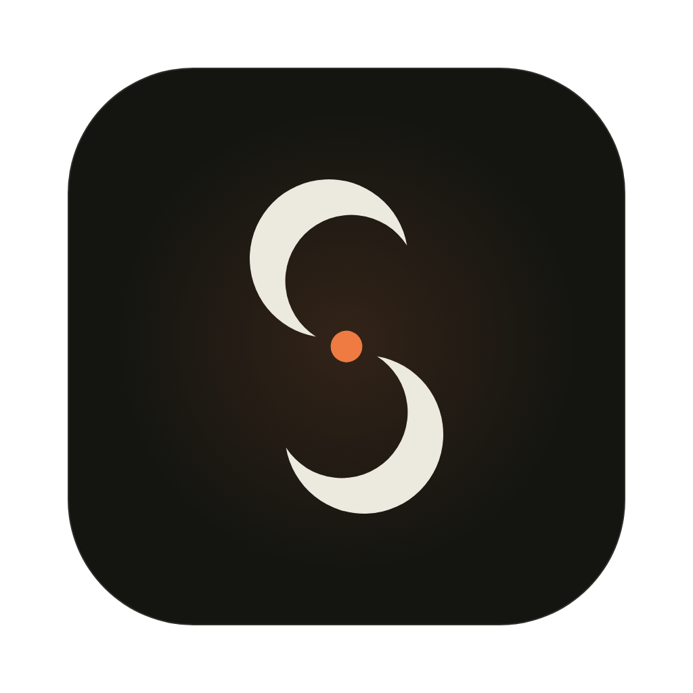

<div align="center">



# Sinapsi

**English** · [Italiano](README.it.md)

**A macOS study app that turns your Obsidian notes into active recall, Socratic practice and a plan towards the exam.**

Electron · React 19 · TypeScript · FSRS-5 · macOS

</div>

> The app's interface is in Italian. The code, comments and this README are in English.

---

## What it is

Rereading notes feels like knowing them, until a new problem shows otherwise. Sinapsi starts from the notes you already keep in your Obsidian vault and makes you work with them: it asks you to recall instead of recognise, guides you with questions instead of handing you the solution, and schedules reviews for when you are about to forget.

Three principles hold the whole app together:

- **The vault is read-only.** Sinapsi reads your notes and never writes to your Markdown files. Everything it produces lives in its own data folder.
- **Attempt first, help second.** The tutor never gives away the solution: hints unlock one rung at a time, and only after you have tried.
- **Mastery is measured, not declared.** How well you know a concept is the recall probability FSRS estimates from your answers, not a box you tick.

## What it does

### Today, Map, Plan

The interface is a "cockpit" with a sidebar and a liquid dock at the bottom, with three destinations:

- **Oggi (Today).** What to study now: suggestions, concepts due for review, lessons to digest, readiness for the next exam. The "Cosa vuoi studiare?" composer starts a session on any topic.
- **Mappa (Map).** The concept graph of your living notes. Nodes are statements and edges are deduction chains (premises → conclusion). It is coloured by memory state and can be filtered to what is due, never seen, or resting on weak foundations.
- **Piano (Plan).** Exams with their dates, a weekly plan built on your study hours, and a readiness index for each exam.

The sidebar splits subjects (the top-level folders of the vault) into **university** and **personal**. You can reorder them by dragging or with the arrow buttons, and the order is saved.

### Socratic study sessions

A study session on a note or on any topic. The tutor starts from what you already know (the memory of that note's concepts), asks questions, asks you to explain, and offers short games (Lampo, Coppie, Ricomponi, Trova l'intruso, Tabù). Session names are saved in Title Case.

### Living notes (note vive)

From an Obsidian note, Sinapsi writes an interactive handout made of validated blocks:

- definitions and theorems;
- a three-level decoding (formula, plain-language reading, intuition);
- step-by-step proofs;
- SVG figures with sliders and draggable points.

Formulas are rendered with KaTeX and diagrams with Mermaid. Proofs and exercises stay hidden until you have made an attempt. If the note contains a mistake, the living note flags it and prepares the fix for you to paste into Obsidian.

### Review with FSRS-5

Spaced repetition with `ts-fsrs`. Recall probability uses fractional days, so it changes over the day. For each concept the AI prepares several question variants:

- open answer, multiple choice, true/false;
- step ordering, cloze, matching;
- counterexample, estimate, spot the error, graph;
- "Spiegalo tu" (explain it yourself).

Before answering you state how sure you are, and a confident wrong answer flags a possible misconception.

### Practice and exam simulation

- **Training.** Problems on up to four concepts, with a six-rung hint ladder (from "attention" to "worked step"). Hints unlock only after an attempt and after you say where you are stuck.
- **Exam simulation.** Timed, no help, graded out of 30. It can also be done on paper: photograph your sheet with your iPhone (Continuity Camera), the grader reads the formulas, and you self-assess.

### Lesson log and Sinapsi's own tutor

The Registro (lesson log) collects your course lessons. The lessons and the concepts each one introduced come from the lesson tutor in the vault (`.antigravity/tutor`, read and never modified). Coverage and mastery, however, are computed by Sinapsi alone, from your reviews and practice.

Each lesson concept is in one of these states:

- internalised;
- in progress;
- fragile;
- never studied;
- to extract (with a button to extract the note's concepts);
- no note.

### Study pacing

Two optional settings, both off by default:

- micro-pauses of 15 seconds every 10 minutes of study;
- a session length limit (50 minutes, then a 10-minute break).

They apply to study, review and practice, and only count time while the window is visible.

### Dictation

You can dictate into any text field (also with ⌥ Space). Transcription runs locally with `mlx_whisper` on Apple Silicon, through a small server that keeps the model loaded.

### Themes

Two themes, **Lavagna** (dark) and **Trattato** (light), with a glass switch in the settings. The visual material is Liquid Glass (`@glass-sdk/liquid-glass`), and text contrast meets WCAG AA.

## How it works

```
Obsidian vault (read-only) ──► note index ──► concept extraction (AI)
                                                      │
                          append-only JSONL ledgers (data folder)
                          propositions · chains · reviews · lessons · sessions
                                                      │
              Main process (Node) ◄── typed IPC (src/shared/api.ts) ──► Renderer (React)
```

- **Main process** (`src/main`): vault and watcher, graph, FSRS memory, sessions, practice, exams, plan, lesson tutor, dictation, and the bridge to the AI engines.
- **Preload** (`src/preload`): exposes to the renderer only the channels declared in `src/shared/api.ts`.
- **Renderer** (`src/renderer/src`): the shell (`shell/`) and the views (`lessons/`, `review/`, `practice/`, `session/`, `nota/`, `graph/`, `plan/`).
- **Data**: append-only `.jsonl` ledgers. State (FSRS memory, graph, lessons) is rebuilt by replaying them, and every payload goes through a Zod schema.

The full reference is in [`docs/ARCHITECTURE.md`](docs/ARCHITECTURE.md) (in Italian).

## AI engines

Sinapsi uses no API keys: it calls the command-line tools already installed and signed in with your own subscriptions.

| Engine | CLI | Used for (default) |
| --- | --- | --- |
| Gemini, through Antigravity | `agy` | concept extraction, living notes, review questions |
| Claude, through Claude Code | `claude` | study and practice tutor, grading and sheet photos |

You can change the engine and model for each task in **Impostazioni → Motori AI**. If a CLI asks you to sign in, run it once in a terminal (`agy` or `claude`), complete the login and reopen Sinapsi.

Optional: `pip install mlx-whisper` for dictation, and `yt-dlp` for video sources.

## Getting started

Requirements: macOS 13 or later (Apple Silicon recommended) and Node.js 20 or later.

```bash
git clone https://github.com/andrevvuuuu/sinapsi.git
cd sinapsi
npm install
npm run dev
```

The default vault is `~/Obsidian Vault`; you can change it in the settings.

### Building the app

```bash
npm run build:unpack   # dist/mac-arm64/Sinapsi.app, no installer
npm run dist           # .app and .dmg in dist/
```

The app is not signed with a Developer ID: the first time, open it with right-click → Open.

## Development

```bash
npm test            # unit tests (Vitest)
npm run typecheck   # TypeScript, main and renderer
npm run lint        # ESLint
npm run test:e2e    # end-to-end tests with Playwright on the Electron app
```

Some unit tests already fail on the main branch, mostly in modules being phased out (notebook and the old Home). Before merging a change, compare its failures with those on the main branch rather than expecting zero.

### Environment variables

| Variable | Effect |
| --- | --- |
| `SINAPSI_DATA` | alternative data folder (default `~/Library/Application Support/Sinapsi`); also used to isolate test instances |
| `SINAPSI_VAULT` | vault path, overriding the one in the settings |
| `SINAPSI_FAKE_EXTRACT`, `SINAPSI_FAKE_NOTE`, `SINAPSI_FAKE_REVIEW`, `SINAPSI_FAKE_TEACHER`, `SINAPSI_FAKE_PRACTICE`, `SINAPSI_FAKE_MEDIA` | set to `1` to replace that module's AI engine or media with deterministic fake responses, for offline work and tests |

See [CONTRIBUTING.md](CONTRIBUTING.md) for the code rules.

## Documentation

- [`docs/ARCHITECTURE.md`](docs/ARCHITECTURE.md): architecture and data flows
- [`docs/design.md`](docs/design.md): the original design
- [`docs/ricerca/il-mio-metodo.md`](docs/ricerca/il-mio-metodo.md): the study method behind the app
- [`reports/ui-reference/STYLE.md`](reports/ui-reference/STYLE.md): the interface style

The documents in `docs/` are in Italian.

## Security

To report a vulnerability, see [SECURITY.md](SECURITY.md).
