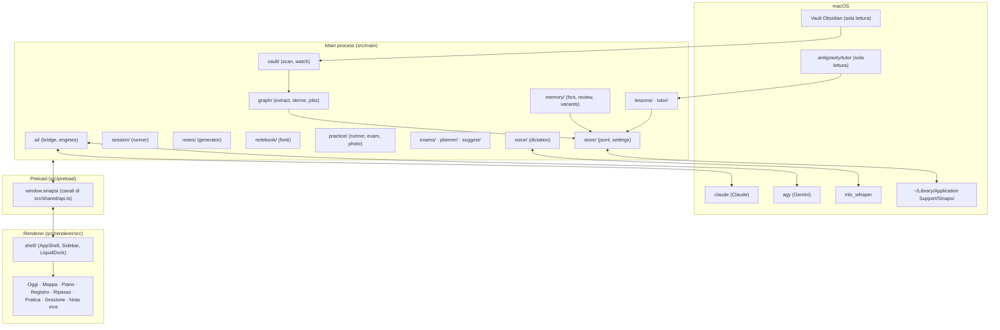
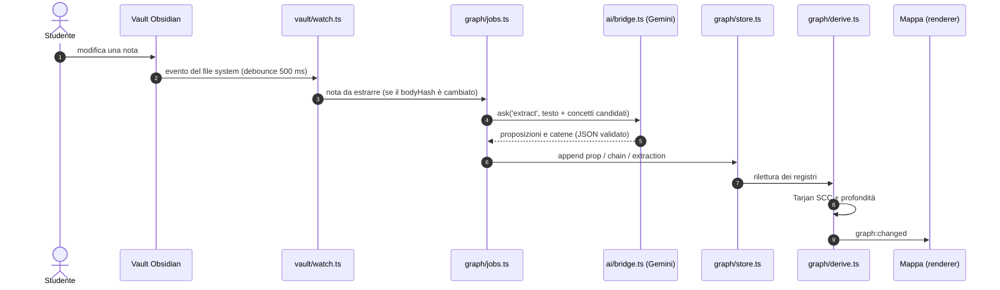
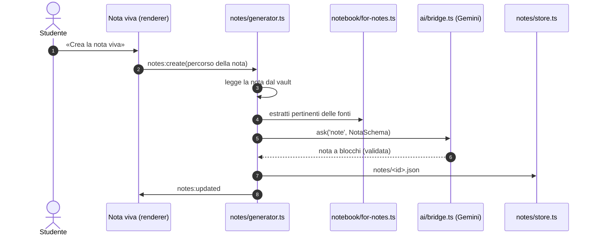
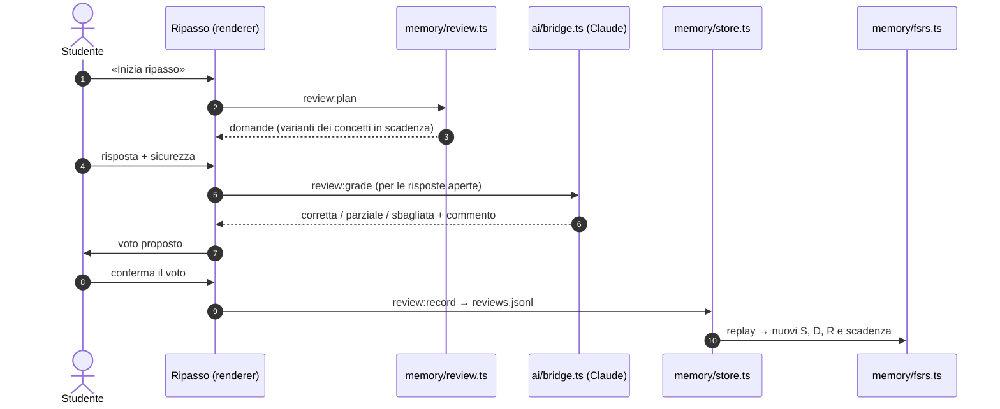
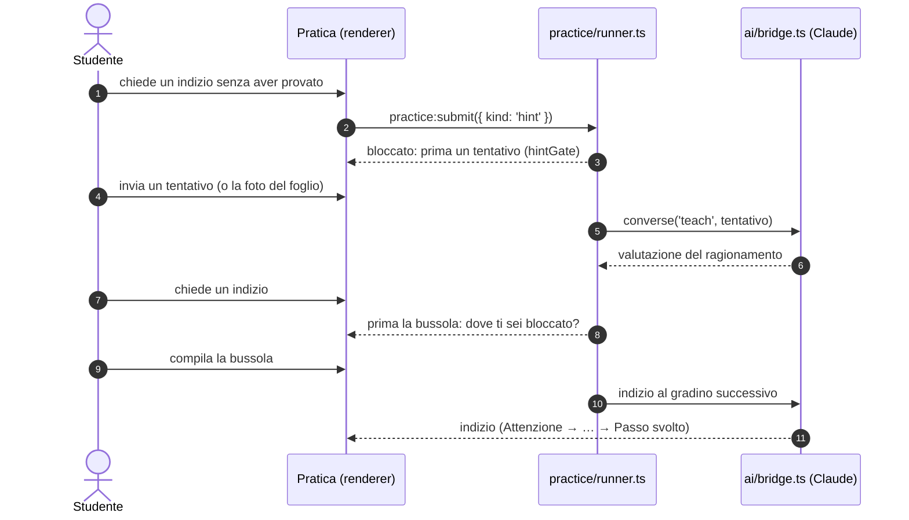
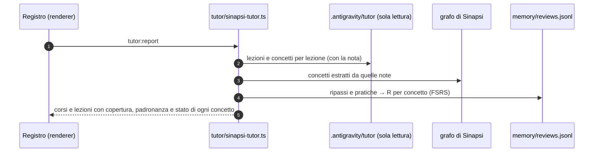

# Architettura di Sinapsi

> Reference tecnica per chi lavora sul codice. Descrive l'app com'è sul ramo `main`.
> **Versione:** 0.1.0 · **Piattaforma:** macOS (Apple Silicon consigliato) · **Runtime:** Electron 44 + Node (main) · React 19 + TypeScript (renderer)

---

## Indice

1. [Modello pedagogico](#1-modello-pedagogico)
2. [Principi architetturali](#2-principi-architetturali)
3. [Mappa del sistema](#3-mappa-del-sistema)
4. [Main process](#4-main-process)
   - [4.1 Ponte verso i motori AI](#41-ponte-verso-i-motori-ai)
   - [4.2 Vault Obsidian](#42-vault-obsidian)
   - [4.3 Grafo dei concetti](#43-grafo-dei-concetti)
   - [4.4 Memoria FSRS-5 e Ripasso](#44-memoria-fsrs-5-e-ripasso)
   - [4.5 Sessioni di studio socratico](#45-sessioni-di-studio-socratico)
   - [4.6 Note vive](#46-note-vive)
   - [4.7 Fonti delle note vive (notebook)](#47-fonti-delle-note-vive-notebook)
   - [4.8 Pratica e simulazione d'esame](#48-pratica-e-simulazione-desame)
   - [4.9 Registro lezioni e tutor di Sinapsi](#49-registro-lezioni-e-tutor-di-sinapsi)
   - [4.10 Esami, piano e prontezza](#410-esami-piano-e-prontezza)
   - [4.11 Suggerimenti](#411-suggerimenti)
   - [4.12 Dettatura locale](#412-dettatura-locale)
   - [4.13 Impostazioni](#413-impostazioni)
5. [Storage e modello dei dati](#5-storage-e-modello-dei-dati)
6. [Preload e IPC](#6-preload-e-ipc)
7. [Renderer](#7-renderer)
8. [Flussi dei dati](#8-flussi-dei-dati)

---

## 1. Modello pedagogico

Rileggere gli appunti dà familiarità, non competenza. Sinapsi costruisce il lavoro di studio sulle note che lo studente ha già scritto in Obsidian e lo organizza attorno a cinque idee:

1. **Richiamo attivo.** Si chiede di ricordare, non di riconoscere: risposte aperte, spiegazioni, controesempi, riordino di passaggi.
2. **Ripetizione spaziata con FSRS-5.** Per ogni concetto si stimano stabilità ($S$), difficoltà ($D$) e probabilità di ricordo ($R$), e il ripasso arriva quando $R$ sta per scendere.
3. **Grafo deduttivo.** Ogni concetto è un enunciato atomico. Le relazioni sono catene di deduzione orientate $\{\text{premesse}\} \implies \text{conclusione}$, non semplici collegamenti.
4. **Prima il tentativo, poi l'aiuto.** Il tutor non dà la soluzione. Gli indizi si sbloccano solo dopo un tentativo documentato e una dichiarazione del punto di blocco.
5. **Padronanza misurata.** Quanto un concetto è interiorizzato si ricava dalle risposte (FSRS sui ripassi e sulle pratiche), non da una dichiarazione dello studente.

---

## 2. Principi architetturali

- **Vault in sola lettura.** Sinapsi legge il vault (`~/Obsidian Vault` o il percorso impostato) e **non scrive mai** nei suoi file. Un errore trovato in una nota diventa un blocco `flag` nella nota viva, con la correzione da copiare in Obsidian. La stessa regola vale per i dati del tutor delle lezioni in `.antigravity/tutor/`.
- **Registri in sola aggiunta.** I dati sono file JSONL a cui si aggiungono righe. Lo stato (memoria FSRS, grafo, lezioni, esami, sessioni) si **ricostruisce rileggendo i registri**; nessuna riga viene modificata.
- **Un solo scrittore per registro.** Ogni registro ha un modulo che può scriverci. Le scritture sono serializzate con catene di promesse, quindi due eventi non si intrecciano.
- **Nessuna chiave API.** I motori sono le CLI già autenticate sul Mac, con i propri abbonamenti:
  - **Antigravity (`agy`)** per Gemini;
  - **Claude Code (`claude`)** per Claude.
- **Renderer isolato.** `contextIsolation: true`, `sandbox: true`, niente Node nel renderer. Il renderer parla col main solo attraverso i canali dichiarati in `src/shared/api.ts`.
- **Zod ai confini.** Gli argomenti IPC, i file di dati e le risposte dei modelli passano da schemi Zod. Uno schema con `.catch()` per ogni campo permette di caricare anche un file parziale o rovinato.

---

## 3. Mappa del sistema



---

## 4. Main process

Il punto d'ingresso è `src/main/index.ts`, che crea la finestra. `src/main/ipc.ts` collega i servizi e registra i canali IPC; `src/main/ipc-handlers.ts` raccoglie gli handler puri, quelli testabili senza Electron.

### 4.1 Ponte verso i motori AI

`src/main/ai/`:

- `bridge.ts`: l'interfaccia `Bridge` con `ask<T>()` e `converse<T>()`, una coda per motore, la cache e il rilevamento del logout.
- `engines.ts`: costruisce gli argomenti delle due CLI e avvia i processi.
- `json.ts`: estrae il JSON dalla risposta, anche dentro i fence Markdown.
- `errors.ts`: `AuthRequiredError`, `EngineMissingError`, `AiTimeoutError`, `AiSchemaError`.
- `rigor.ts`: le regole di rigore condivise da ogni prompt che corregge (cercare il primo passaggio non giustificato, non farsi convincere dal tono).

Argomenti principali:

- `agy`: `-p <prompt> --output-format json --print-timeout <s> --disable-slash-commands [--conversation <id>] [--model <m>] [--json-schema <s>]`
- `claude`: `-p <prompt> --output-format json [--resume <id> | --session-id <id>] [--system-prompt <p>] [--model <m>] [--json-schema <s>] [--tools …] [--setting-sources …] [--strict-mcp-config]`

Robustezza:

1. **Una chiamata alla volta per motore.** Ogni motore ha la sua coda di promesse.
2. **Gruppo di processi.** I figli partono con `detached: true`. A un timeout o a un annullamento l'intero gruppo riceve `SIGTERM` e poi `SIGKILL`, e la promessa si risolve anche se un nipote tiene aperti i pipe.
3. **Timeout.** Il timeout predefinito è 180 s; le note vive hanno un timeout più lungo.
4. **Cache.** Le richieste deterministiche con `cache: true` sono indicizzate da SHA-256 di motore, modello, prompt e schema, in `ai-cache/`. L'uso viene registrato in `ai-usage.jsonl`.
5. **Logout.** `AUTH_RE` riconosce subito le richieste di login e solleva `AuthRequiredError`, così l'interfaccia può dire di aprire la CLI nel terminale.

Motori predefiniti (`DEFAULT_ENGINES` in `src/shared/settings-schema.ts`):

| Compito | Motore e modello |
| --- | --- |
| `extract`, `note` | Gemini `gemini-3.8-flash-medium` |
| `variants` | Gemini `gemini-3.8-flash-high` |
| `teach`, `grade` | Claude `sonnet` |

Si cambiano per compito in **Impostazioni → Motori AI**.

### 4.2 Vault Obsidian

`src/main/vault/`:

- `scan.ts`: indicizza il vault. Esclude le cartelle di configurazione (`.obsidian`, `.antigravity`, `.trash`, `Prompts` e quelle impostate), legge il frontmatter con `gray-matter`, i collegamenti, i titoli, gli alias e l'esito della verifica di correttezza (`Verifica`). I percorsi delle note sono assoluti; `folder` è relativo alla radice del vault.
- `watch.ts`: osserva il vault con `chokidar`, con un debounce di 500 ms, e si ricollega quando cambia il percorso del vault.
- `links.ts`: legge `[[Nota]]`, `[[Nota#Sezione|Alias]]` e i link a blocco.
- `body-hash.ts`: SHA-256 del corpo senza frontmatter. Una modifica ai soli metadati non rigenera la nota viva.
- `linked.ts`: quando una nota cambia, aggiorna la sua nota viva e i concetti delle note collegate.
- `subjects.ts`: i colori delle materie, letti da `.obsidian/graph.json`.
- In `graph/moves.ts`: rinomine e spostamenti, così i concetti seguono la propria nota.

### 4.3 Grafo dei concetti

`src/main/graph/`: `store.ts`, `extract.ts`, `extract-prompt.ts`, `derive.ts`, `jobs.ts`, `moves.ts`.

- **Concetto (`Concept`):** un enunciato atomico con `id`, `name`, `statement`, `birth` (la nota d'origine), `notes` (tutte le note in cui compare) e `depth`.
- **Catena (`Chain`):** un iperarco $\{\text{premesse}\} \implies \text{conclusione}$.
- **Estrazione:** il modello riceve il testo della nota e un elenco di concetti candidati (`pickCandidates`), così un concetto già noto viene riusato invece di essere duplicato.
- **Profondità di inferenza (`derive.ts`):** la lunghezza del cammino di premesse più lungo verso ogni nodo. I cicli sono prima collassati con l'algoritmo di **Tarjan** (componenti fortemente connesse), quindi i membri di un ciclo condividono una profondità e la ricorsione termina.
- **Estrazione in background (`jobs.ts`):** una coda con priorità. Prima le note aperte o studiate; poi, a Mac inattivo (`powerMonitor.getSystemIdleTime()`), fino a `dailyExtractionLimit` note al giorno (6 per impostazione predefinita). Un controllo che trova la nota invariata non chiama l'AI e non conta nel limite.

Nel renderer (`src/renderer/src/graph/`), `layout.ts` calcola tre disposizioni con D3 (`radial`, `vertical`, `free`) e `model.ts` filtra il grafo. La **Mappa** della shell mostra solo i concetti delle note vive (`liveOnly`): un concetto condiviso con una nota più vecchia appartiene al grafo e ha sede nella nota viva.

### 4.4 Memoria FSRS-5 e Ripasso

`src/main/memory/`.

`fsrs.ts` usa `ts-fsrs` (FSRS-5). Le schede non sono mai salvate: `replay(reviews)` le ricostruisce riapplicando in ordine le righe di `reviews.jsonl`. La probabilità di ricordo usa giorni frazionari, perché `ts-fsrs` arrotonda a giorni interi e terrebbe $R$ al 100% per tutto il giorno del ripasso:

$$R(t, S) = \left(1 + \tfrac{19}{81}\cdot\tfrac{t}{S}\right)^{-0.5}$$

Subito dopo un errore la scheda è in (ri)apprendimento: «Di nuovo» mostra il concetto come debole e «Difficile» come incerto, anche se la curva direbbe ancora quasi 100%.

Gli stati mostrati sono: `la sai` ($R \ge 0.85$), `incerto` ($R \ge 0.6$), `debole` e `mai visto`.

- **Voti:** 1 Di nuovo, 2 Difficile, 3 Bene, 4 Facile. L'app propone un voto dalla correttezza e dalla sicurezza dichiarata, e lo studente può cambiarlo.
- **Misconcezioni:** una risposta sbagliata data con sicurezza $\ge 70$ segna il concetto come possibile misconcezione.
- **Calibrazione:** la sicurezza media confrontata con le risposte corrette, per concetto e per corso.
- **Varianti (`variants.ts`):** per ogni concetto Gemini prepara un gruppo di domande validate da `ExerciseSchema` (`src/shared/exercise-schema.ts`). I tipi sono `open`, `mc`, `truefalse`, `order`, `fill`, `match`, `counterexample`, `estimate`, `spoterror`, `graph`, `explain`. Il filtro PACER sceglie i tipi adatti al genere della lezione (`PACER_EXERCISE_TYPES`).
- **«Spiegalo tu» (`explain.ts`):** lo studente spiega a libro chiuso (a voce o scritto) e uno «studente pignolo» lo corregge sulla nota.
- **Fading (`fading.ts`):** un concetto risolto due volte senza aiuti, in pratica e in giorni diversi, conta come indipendente; il tutor e la nota viva ne tengono conto.
- La memoria dei ripassi e quella della pratica sono la stessa: le righe di pratica hanno `via: 'practice'`, il gradino d'aiuto (`rung`) e un `ref`, così una correzione ripetuta non scrive due volte.

### 4.5 Sessioni di studio socratico

`src/main/session/`:

- `runner.ts`: crea una sessione su un argomento libero o su una nota (`note-match.ts` trova la nota più vicina all'argomento), poi alterna i turni dello studente e del tutor.
- `prompt.ts`: il prompt del tutor.
- `memory-brief.ts`: un riassunto della memoria dei concetti di quella nota, per partire da ciò che lo studente sa già.
- `events.ts`: gli eventi e la ricostruzione dello stato di una sessione da `sessions/<id>.jsonl`.

I giochi (Lampo, Coppie, Ricomponi, Trova l'intruso, Tabù) si disattivano dalle impostazioni. Il nome della sessione viene salvato in Title Case (`toTitleCase` in `src/shared/subjects.ts`), mentre il testo mandato al modello resta quello scritto.

### 4.6 Note vive

`src/main/notes/` genera; `src/renderer/src/nota/` mostra.

Il generatore non produce HTML: produce uno schema dichiarativo, `NotaSchema` (`src/shared/nota-schema.ts`). I blocchi sono:

- `theorem`: enunciati formali;
- `decode`: la stessa idea su tre livelli (formula, lettura in italiano, intuizione);
- `proof`: dimostrazione a passi, sincronizzata con la figura;
- `figure`: figura SVG parametrica, con cursori (`params`), curve compilate in sicurezza (`compileExpr`), punti trascinabili e condizioni `greenWhen`;
- `tryit`: «Prova da solo», con la soluzione coperta fino al tentativo;
- `flag`: un errore rispetto alla nota Obsidian, con la correzione da copiare.

Le formule passano sempre per `$…$` e sono rese con KaTeX; i diagrammi con Mermaid, nei colori del tema. Se la formattazione delle formule fallisce, la nota viene rimandata una volta al modello e poi salvata comunque con un avviso: la matematica non fa mai perdere una nota.

### 4.7 Fonti delle note vive (notebook)

`src/main/notebook/` raccoglie fonti complementari per materia (PDF, slide, audio e video, YouTube) e ne estrae il testo:

- PDF con `pdfjs-dist`, togliendo testate e piè di pagina ricorrenti;
- `.pptx` con `fflate`;
- audio e video trascritti in locale con `mlx_whisper`;
- YouTube con `yt-dlp`.

`for-notes.ts` sceglie gli estratti pertinenti quando si scrive una nota viva. Il notebook non ha più una schermata propria: i canali IPC delle fonti esistono ancora, la vecchia chat è stata tolta.

### 4.8 Pratica e simulazione d'esame

`src/main/practice/`:

- `material.ts`: il materiale di un allenamento, cioè fino a quattro concetti, le fonti o un argomento libero.
- `runner.ts`: un allenamento è una sequenza di problemi in tre modi (`recall`, `discrimination`, `composition`). Ogni problema si chiude come risolto, risolto con aiuti o abbandonato, e l'errore viene classificato (`MISSES`).
- **Scala di indizi** (`RUNG_IT` in `src/shared/practice-protocol.ts`), sei gradini: Attenzione, Schema, Candidati, Proposizione, Mossa, Passo svolto.
- **Cancello degli indizi (`hintGate`):** senza un tentativo non si sbloccano indizi. Dopo il primo tentativo serve la «bussola», cioè dire dove ci si è bloccati (`ConfusionCompassCard` nel renderer). `checkTurnAgainst` respinge i turni del modello che violano le regole: due problemi aperti, id riusati, indizi senza problema.
- `exam.ts`: la simulazione d'esame. È a tempo, senza aiuti, con salvataggio continuo, consegna allo scadere e voto in trentesimi. Si può svolgere **su carta** con autovalutazione e calibrazione.
- `photo.ts`: la foto del foglio, da Continuity Camera o da file. Claude trascrive testo e formule per la correzione.

### 4.9 Registro lezioni e tutor di Sinapsi

`src/main/lessons/`:

- `store.ts`: il registro in sola aggiunta `lessons.jsonl`, con eventi come `lesson-created`, `lesson-updated`, `digest-done`, `confusion-added`, `mastery-changed`.
- `reduce.ts`: ricostruisce le lezioni (`LessonEntrySchema` in `src/shared/lesson-types.ts`). Una lezione ha il nucleo 80/20, il tipo PACER, i concetti, le domande di confusione aperte e i passi di digestione (subito, richiamo a 24 ore, ripasso settimanale).
- `launch.ts`: avvia da una lezione la pratica o il ripasso dei suoi concetti.

`src/main/tutor/`:

- `calendar.ts` (`readTutorCalendar`): legge in sola lettura i file del tutor delle lezioni di Obsidian in `.antigravity/tutor/` (`courses.json`, `lessons.jsonl`, `state.json`). Ne ricava corsi, orario, prossima lezione ed esami. È tollerante: un corso o una riga malformati non nascondono gli altri.
- `sinapsi-tutor.ts` (`createSinapsiTutorService`, canale `tutor.report()`): **il tutor di Sinapsi.**
  - Dal tutor di Obsidian prende solo il collegamento: quali lezioni ci sono state e quali concetti ha introdotto ciascuna, con la nota del vault in cui stanno. Il suo giudizio «coperto» viene ignorato.
  - Ogni concetto della lezione viene collegato ai concetti che Sinapsi ha estratto da quella nota (per titolo, poi per percorso tramite l'indice del vault).
  - La padronanza è la media di $R$ su quei concetti; quelli mai ripassati contano 0.
  - Stati: `interiorizzato` ($\ge 0.85$), `in corso` ($\ge 0.6$), `fragile`, `mai studiato`, `da estrarre` (la nota esiste ma non è ancora stata estratta) e `scollegato` (nessuna nota).
  - `buildTutorReport` è una funzione pura, testata in `tests/unit/sinapsi-tutor.test.ts`.

### 4.10 Esami, piano e prontezza

- `src/main/exams/`: il registro `exams.jsonl` (crea, modifica, archivia).
- `src/main/planner/plan.ts`: il piano della settimana, distribuito sulle ore di studio di ogni giorno (`studyHours`) con un margine (`planBuffer`).
- `src/main/planner/readiness.ts` (`readinessFor`): la prontezza per un esame da cinque segnali:
  - prove risolte senza indizi;
  - errori spiegati;
  - collegamenti nel grafo;
  - spiegazione ad alta voce superata;
  - nessun dubbio aperto.

### 4.11 Suggerimenti

`src/main/suggest/suggest.ts` sceglie i suggerimenti della vista Oggi: sessioni da finire, note che fanno da base a molte altre, concetti che servono a ciò che stai studiando. Lavora su grafo, memoria, note vive e sessioni.

### 4.12 Dettatura locale

`src/main/voice/dictation.ts` e `resources/whisper_server.py`:

- un server Python che tiene caricato `mlx_whisper` (Apple MLX su GPU Metal) e dà segni di vita durante le registrazioni lunghe;
- un tetto di 10 minuti per caricamento e trascrizione;
- nel renderer, `components/dictation.ts` e `MicButton.tsx`: il testo dettato si inserisce al cursore e non viene mai inviato da solo. ⌥ Spazio agisce sul campo attivo.

### 4.13 Impostazioni

`src/main/store/settings.ts` legge e scrive `settings.json`. Lo schema è `settingsSchema` (`src/shared/settings-schema.ts`): ogni campo ha un valore di riserva, quindi un file parziale si carica comunque. Le modifiche dal renderer passano da `Patch` (`ipc-handlers.ts`), che è `strict`.

| Campo | Significato |
| --- | --- |
| `vaultPath`, `excludedFolders` | il vault e le cartelle da ignorare |
| `theme` | `lavagna`, `trattato` o `system` |
| `engines` | motore e modello per compito |
| `backgroundExtraction`, `dailyExtractionLimit` | estrazione a Mac inattivo |
| `reviewSessionSize`, `exerciseTypes`, `gamesInSessions` | Ripasso e sessioni |
| `studyHours`, `planBuffer` | piano settimanale |
| `microPauses` | micro-pause facoltative (`MICRO_PAUSE_SECONDS` = 15 ogni `MICRO_PAUSE_EVERY` = 10 minuti) |
| `sessionLimit`, `sessionLimitMinutes` | limite di durata facoltativo (50 minuti, poi `SESSION_BREAK_MINUTES` = 10 di pausa) |
| `subjectOrder`, `universitySubjects` | ordine delle materie nella barra laterale e quali sono universitarie (`null` finché non si sceglie: valgono quelle di `DEFAULT_UNIVERSITY` in `src/shared/subjects.ts`) |

Micro-pause e limite sono applicati nel renderer da `components/StudyPacer.tsx`, montato in sessione, ripasso e pratica. Conta solo il tempo con la finestra visibile e non interrompe mai il lavoro.

---

## 5. Storage e modello dei dati

Tutto sta in `~/Library/Application Support/Sinapsi/`, oppure in `SINAPSI_DATA`, che i test usano per isolare ogni istanza.

```
~/Library/Application Support/Sinapsi/
├── settings.json
├── lessons.jsonl              # registro lezioni (eventi)
├── exams.jsonl                # esami (eventi)
├── ai-usage.jsonl             # uso dei motori
├── attempts.jsonl             # tentativi «Prova da solo» nelle note vive
├── ai-cache/                  # risposte AI deterministiche (SHA-256)
├── graph/
│   ├── propositions.jsonl     # concetti
│   ├── chains.jsonl           # catene premesse ⇒ conclusione
│   ├── extractions.jsonl      # note estratte, con hash ed esito
│   ├── moves.jsonl            # rinomine e spostamenti di note
│   └── positions.json         # posizioni dei nodi nella Mappa
├── memory/
│   ├── reviews.jsonl          # ogni risposta: l'unica prova di memoria
│   ├── variants.jsonl         # domande preparate per concetto
│   └── explain-checked.jsonl  # spiegazioni «Spiegalo tu» già verificate
├── notes/<id>.json            # note vive
├── notebook/                  # fonti per materia (notebooks.jsonl, sources.jsonl, testi estratti)
├── practice/                  # allenamenti ed esami
└── sessions/<id>.jsonl        # eventi delle sessioni di studio
```

Esempi di righe:

```json
// graph/propositions.jsonl
{ "id": "teorema-lagrange", "name": "Teorema di Lagrange", "statement": "Se f è continua in [a,b] e derivabile in (a,b), esiste c in (a,b) con f'(c) = (f(b) − f(a))/(b − a)", "notePath": "/…/Matematica/Analisi 1/…/Teorema di Lagrange.md", "at": 1762810000000 }

// graph/chains.jsonl
{ "id": "chain-lagrange", "premises": ["teorema-rolle"], "conclusion": "teorema-lagrange", "notePath": "/…/Teorema di Lagrange.md", "at": 1762810000000 }

// memory/reviews.jsonl  (ReviewLineSchema in src/shared/memory-types.ts)
{ "conceptId": "teorema-lagrange", "at": 1762812000000, "grade": 3, "confidence": 85, "correct": true, "type": "open", "via": "review" }
```

---

## 6. Preload e IPC

Il contratto è `SinapsiApi` in `src/shared/api.ts`. Lo espone `src/preload/index.ts` come `window.sinapsi`; i nomi dei canali sono nella costante `CH`.

| Area | Metodi principali | Note |
| --- | --- | --- |
| `settings` | `get`, `set`, `chooseVault` | `set` accetta un patch validato |
| `vault` | `index`, `onChange` | |
| `ai` | `status`, `onStatus` | pronto, occupato, serve l'accesso |
| `session` | `start`, `answer`, `say`, `retry`, `list`, `get` | lo stato arriva con `session:updated` |
| `notes` | `create`, `list`, `get`, `retry`, `attempt` | |
| `graph` | `get`, `extract`, `status`, `onChange`, `positions`, `savePositions` | |
| `review` | `plan`, `grade`, `explain`, `record`, `memory`, `calibration`, `intervals`, `sessions` | |
| `practice` | `catalog`, `create`, `submit`, `retry`, `get`, `list`, `exam*`, `photo`, `camera`, `calibration` | lo stato arriva con `practice:updated` |
| `lessons` | `list`, `get`, `create`, `update`, `addConfusion`, `resolveConfusion`, `setMastery`, `archive`, `launch` | |
| `tutor` | `calendar`, `report` | calendario del tutor di Obsidian; report del tutor di Sinapsi |
| `exams` | `list`, `create`, `update`, `archive` | |
| `plan` | `week` | piano e prontezza |
| `suggest` | `get` | |
| `notebook` | gestione delle fonti | senza schermata propria |
| `voice` | `transcribe`, microfono, stato del modello | |
| `ui` | trasparenza ridotta di sistema | |

Le operazioni lunghe (turni del tutor, pratica, note vive) rispondono subito. Il risultato arriva poi con un evento di aggiornamento, così la finestra non resta bloccata.

---

## 7. Renderer

React 19 con Vite ed Electron-Vite. `App.tsx` decide la vista; la shell sta in `src/renderer/src/shell/`.

### Shell «Cabina»

- **`AppShell.tsx`**: la barra laterale, la colonna principale e il dock. Il dock sta fuori dal `<main>` con `key`, così cambiare schermata non lo rimonta e l'onda del dock può animarsi.
- **`Sidebar.tsx`**: logo (torna a Oggi), Ripassa ed Esercitati, Registro, materie universitarie e personali e Impostazioni.
  - Le materie sono le cartelle di primo livello del vault. Le cartelle di sistema (`00 Meta`, `01 MOC's`, `_x`, `.x`) sono nascoste solo in cima al vault: dentro una materia le cartelle numerate sono i capitoli e restano.
  - I due gruppi si aprono e chiudono ciascuno per conto suo.
  - «Ordina» permette di trascinare le materie, spostarle con le frecce o cambiarle di gruppo (`arrangeSubjects`, `moveSubject`, `placeSubject` in `src/shared/subjects.ts`, salvati in `subjectOrder` e `universitySubjects`).
- **`LiquidDock.tsx`**: tre destinazioni, **Oggi**, **Mappa** e **Piano**. Le molle sono integrate sul tempo reale (fluide a 60 e 120 Hz), con hover, frecce da tastiera e `prefers-reduced-motion`. Sulle altre schermate la cupola si appiattisce.
- **`ThemeSwitch.tsx`**: l'interruttore di vetro chiaro/scuro con l'icona a pixel. È l'unico controllo del tema e sta nelle Impostazioni.
- **`TodayView.tsx`**, **`MapView.tsx`**: le viste Oggi e Mappa.

### Viste

`lessons/` (Registro), `review/` (Ripasso), `practice/` (Esercitati, pratica, esame, esame su carta), `session/` (studio socratico e giochi), `nota/` (note vive), `graph/` (grafo D3), `plan/` (Piano). La vecchia `home/` non è più montata; `SettingsDialog`, `NoteTree`, `LogoMark` e pochi altri componenti vivono ancora lì e la shell li riusa.

### Stile

- **Token** in `src/renderer/src/styles/tokens.css`: colori, spazi (`--s-*`), raggi (`--r-*`), tipografia, stati dei bottoni, per i temi `lavagna` (grafite, accento viola) e `trattato` (carta). Font Geist.
- **Vetro**: `@glass-sdk/liquid-glass` per superfici, bottoni e segmenti, spento con «Riduci trasparenza». Un `GlassButton` di taglia `icon*` è sempre un cerchio: per un quadrato arrotondato serve una taglia normale con `radius`.
- **Controlli firma**: `shell/signature.css` (interruttore del tema, dock, chip a inchiostro).
- **Livelli (z-index)**: contenuto delle viste sotto 10, dock 20, dialoghi delle viste 60, Impostazioni 80.
- Alcuni test leggono il testo dei CSS con delle espressioni regolari (`home.css`, `graph.css`): non riformattare quei file.
- Contrasti AA per il testo. Il riferimento visivo è `reports/ui-reference/STYLE.md`.

---

## 8. Flussi dei dati

### 8.1 Dal vault al grafo



### 8.2 Una nota viva



### 8.3 Un ripasso



### 8.4 Pratica con indizi



### 8.5 Il report del tutor di Sinapsi


