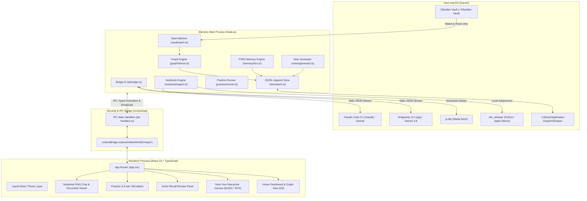
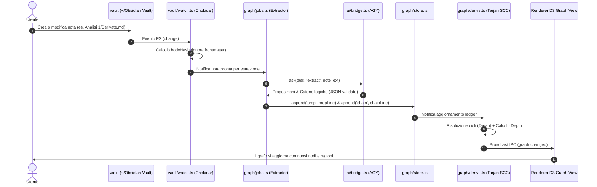
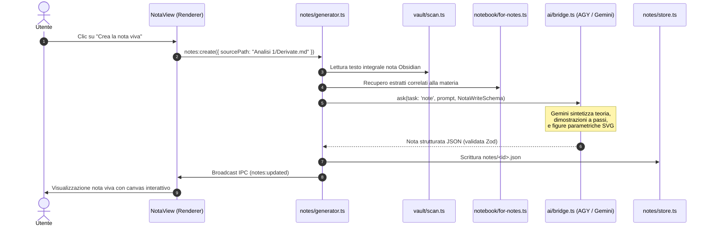
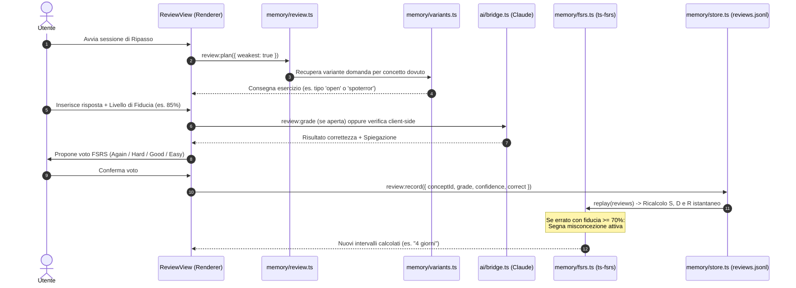
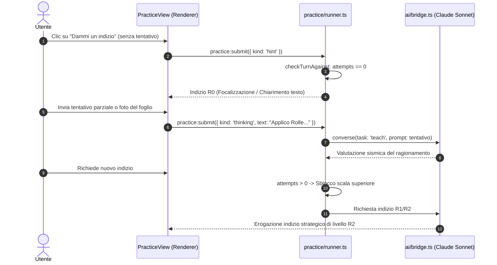

# Architettura Tecnica di Sinapsi

> Documento di specifica architetturale e reference tecnica per sviluppatori, maintainer e collaboratori.
> **Versione:** 0.1.0  
> **Piattaforma:** macOS (Apple Silicon / Intel)  
> **Runtime:** Electron + Node.js (Main) + React 19 & TypeScript (Renderer)

---

## Indice

1. [Visione d'Insieme e Modello Pedagogico](#1-visione-dinsieme-e-modello-pedagogico)
2. [Principi Architetturali Fondamentali](#2-principi-architetturali-fondamentali)
3. [Mappa Generale del Sistema](#3-mappa-generale-del-sistema)
4. [Main Process & Sottosistemi Core](#4-main-process--sottosistemi-core)
   - [4.1 Ponte AI CLI (Zero API Keys)](#41-ponte-ai-cli-zero-api-keys)
   - [4.2 Ingestione & Monitoraggio Vault Obsidian](#42-ingestione--monitoraggio-vault-obsidian)
   - [4.3 Grafo della Conoscenza & Teoria dei Grafi](#43-grafo-della-conoscenza--teoria-dei-grafi)
   - [4.4 Algoritmo FSRS-5 & Ripasso Attivo](#44-algoritmo-fsrs-5--ripasso-attivo)
   - [4.5 Note Vive Parametriche & Interactive Canvas](#45-note-vive-parametriche--interactive-canvas)
   - [4.6 Notebook Confinato & Grounded RAG](#46-notebook-confinato--grounded-rag)
   - [4.7 Sessioni di Pratica, Simulazione d'Esame & Continuity Camera](#47-sessioni-di-pratica-simulazione-desame--continuity-camera)
   - [4.8 Dettatura Locale con Apple Silicon Whisper](#48-dettatura-locale-con-apple-silicon-whisper)
5. [Storage & Modello Dati (Append-Only Ledgers)](#5-storage--modello-dati-append-only-ledgers)
6. [Preload & Sicurezza IPC](#6-preload--sicurezza-ipc)
7. [Renderer Process & Design System Liquid Glass](#7-renderer-process--design-system-liquid-glass)
8. [Diagrammi di Sequenza dei Flussi Dati](#8-diagrammi-di-sequenza-dei-flussi-dati)
   - [8.1 Dal Vault al Concept Graph](#81-dal-vault-al-concept-graph)
   - [8.2 Generazione di una Nota Viva](#82-generazione-di-una-nota-viva)
   - [8.3 Ciclo di Ripasso Attivo e Ricalcolo FSRS-5](#83-ciclo-di-ripasso-attivo-e-ricalcolo-fsrs-5)
   - [8.4 Risoluzione Problemi e Scaffolding Socratico](#84-risoluzione-problemi-e-scaffolding-socratico)

---

## 1. Visione d'Insieme e Modello Pedagogico

**Sinapsi** nasce per risolvere la discrepanza strutturale tra l'accumulo passivo di nozioni e la reale ritenzione cognitiva a lungo termine. La maggior parte dei software di produttività (compresi i moderni sistemi PKM basati su Markdown) opera secondo il paradigma dell'archiviazione: l'utente scrive o importa note, le rilegge saltuariamente, ma sperimenta la tipica _illusione di competenza_ (fluency illusion), dimenticando i dettagli logici e le dimostrazioni poche settimane dopo.

Sinapsi ribalta il processo mediante cinque pilastri cognitivi integrati nella pipeline del software:

1. **Active Recall Obbligatorio (Evocazione Attiva):** Nessuna informazione viene presentata passivamente senza un'interrogazione preliminare. La conoscenza viene richiamata dalla memoria a lungo termine attraverso 10 diverse tipologie di varianti generative.
2. **Spaced Repetition Schedule (FSRS-5):** Implementazione del modello _Free Spaced Repetition Scheduler_ basato su equazioni differenziali stocastiche di memoria, che superano i limiti storici di SM-2 (Anki) calcolando stabilità ($S$), difficoltà ($D$) e probabilità istantanea di recupero ($R$).
3. **Deductive Concept Graph (Catene di Inferenza):** I concetti non sono meri tag o collegamenti ipertestuali arbitrari: ogni concetto rappresenta una proposizione o enunciato atomico, e le relazioni sono direzionali di tipo deduttivo $\text{Premesse} \implies \text{Conclusione}$.
4. **Socratic AI Scaffolding (Igiene Cognitiva):** L'AI Tutor non "risolve" gli esercizi né fornisce risposte preconfezionate: costringe lo studente a formulare previsioni, spiegare il ragionamento con proprie parole e sblocca aiuti scalati (scala da R0 a R5) solo dopo un tentativo documentato.
5. **Grounded Source Containment (Esclusività delle Fonti):** Il motore Notebook ingloba fonti primarie (PDF, slide, audio di lezioni, YouTube) e risponde vincolandosi rigidamente al contesto estratto, isolando il prompt contro allucinazioni e citando numericamente ogni frammento.

---

## 2. Principi Architetturali Fondamentali

La progettazione tecnica di Sinapsi rispetta vincoli rigorosi derivati dal framework di affidabilità _Learn Harness_:

- **Strict Read-Only Obsidian Integration:** Sinapsi legge il vault Obsidian locale (`~/Obsidian Vault` o path configurato) e **non scrive né modifica mai alcun file all'interno del vault**. Qualsiasi incongruenza o refuso matematico riscontrato dall'AI viene esposto nell'app sotto forma di `flag` e l'utente può copiare la correzione negli appunti con un solo clic.
- **Append-Only Event Sourcing (La Regola d'Oro):** I dati persistiti sono esclusivamente file sequenziali in sola aggiunta (formato JSONL). Nessun record esistente viene mutato in-place; l'intero stato computazionale (memoria FSRS, grafo unificato, sessioni di pratica) viene **ricostruito deterministicamente rileggendo i registri**.
- **Single Writer Principle:** Ogni registro su disco (`propositions.jsonl`, `chains.jsonl`, `reviews.jsonl`, `moves.jsonl`) possiede un singolo modulo software autorizzato ad aggiungervi righe, gestito tramite catene di promesse (`PromiseChain`) per prevenire lock o interleaving asincrono.
- **Zero API Keys Required (CLI-as-a-Service):** L'infrastruttura non richiede configurazione di chiavi API proprietarie a pagamento o credenziali cloud. Sfrutta i client CLI già autenticati sulla macchina host:
  - **Google Antigravity CLI (`agy`)** con modelli Gemini (default `gemini-3.8-flash-high` e `gemini-3.8-flash-medium`).
  - **Claude Code CLI (`claude`)** con modello Anthropic Claude Sonnet.
- **Process Sandboxing & IPC Typing:** Il processo Renderer (React 19) è completamente isolato (`contextIsolation: true`, `sandbox: true`, `nodeIntegration: false`). La comunicazione col processo Main avviene attraverso un layer Preload tipizzato end-to-end con canali IPC definiti univocamente in `src/shared/api.ts`.

---

## 3. Mappa Generale del Sistema



---

## 4. Main Process & Sottosistemi Core

### 4.1 Ponte AI CLI (Zero API Keys)

I file core risiedono in `src/main/ai/`:

- `bridge.ts`: implementa l'interfaccia `Bridge`, fornendo i metodi `ask<T>()` e `converse<T>()`.
- `engines.ts`: serializza i comandi di spawn per le due CLI e ne effettua il parsing dello standard output JSON.
- `json.ts`: estrazione resiliente di blocchi JSON con supporto a fence Markdown (` ```json ... ``` `).
- `errors.ts`: gerarchia di errori tipizzati (`AuthRequiredError`, `EngineMissingError`, `AiTimeoutError`, `AiSchemaError`).

#### Funzionamento del Bridge

Ogni chiamata invoca la CLI nativa con parametri specifici:

- **Per `agy`:** `agy -p <prompt> --output-format json --print-timeout <secs> --disable-slash-commands [--conversation <id>] [--json-schema <schema>]`
- **Per `claude`:** `claude -p <prompt> --output-format json [--resume <id> | --session-id <id>] [--system-prompt <prompt>] [--json-schema <schema>] [--tools ''] [--disallowedTools <tools>]`

#### Gestione Concorrenza & Robustezza

1. **Accodamento Seriale per Motore:** Per ciascun motore (`agy`, `claude`) è attiva una coda a promesse: viene eseguita una sola richiesta alla volta per motore, impedendo saturazioni di sessione.
2. **Process Group Detached & Tree-Kill:** `nodeSpawn` crea i processi figli con `detached: true` e memorizza il PID di gruppo. In caso di timeout o cancellazione, l'albero di processi viene terminato integralmente con `process.kill(-child.pid, 'SIGTERM')` seguito da `SIGKILL` dopo 2 secondi.
3. **Hard Deadlines:** Il timeout predefinito è di 180 secondi (480s per le note vive); un timer hard deadline a `timeout + 3s` sblocca la promessa indipendentemente dallo stato dei pipe.
4. **Cache crittografica su disco:** Tutte le query deterministiche con `cache: true` vengono hashate via SHA-256 (`engine | model | prompt | schemaId`) e salvate in `ai-cache/<hash>.json`.
5. **Rilevamento Logout:** Espressioni regolari dedicate (`AUTH_RE`) intercettano immediatamente richieste di login interattivo prima del timeout, sollevando `AuthRequiredError` per istruire l'utente ad autenticarsi da terminale.

---

### 4.2 Ingestione & Monitoraggio Vault Obsidian

I file risiedono in `src/main/vault/`:

- `scan.ts`: indicizza il vault escludendo le directory di configurazione (`.obsidian`, `.antigravity`, `.trash`, ecc.). Estrae il frontmatter YAML con `gray-matter`.
- `watch.ts`: osserva il file system in tempo reale tramite `chokidar` (eventi `add`, `change`, `unlink`). Include un debounce di 500ms e gestisce la ri-connessione dinamica quando l'utente modifica il path del vault.
- `links.ts`: parser regex per collegamenti interni `[[NomeNota]]` e `[[NomeNota#Sezione|Alias]]`.
- `body-hash.ts`: calcola lo SHA-256 del corpo della nota escludendo il frontmatter YAML; consente di ignorare modifiche ai soli tag di Obsidian senza riscrivere le note vive.
- `linked.ts`: aggiorna e notifica il grafo e le note collegate in caso di variazione di un file.

---

### 4.3 Grafo della Conoscenza & Teoria dei Grafi

I moduli in `src/main/graph/` (`store.ts`, `derive.ts`, `extract.ts`, `jobs.ts`, `moves.ts`) gestiscono il concept graph unificato.

#### Modello Concettuale

- **Concetto (`Concept`):** Un'asserzione o enunciato atomico con `id`, `name`, `statement`, `birth` (nota d'origine) e note associate.
- **Catena di Inferenza (`Chain`):** Relazione orientata iper-grafica: $\{\text{premesse}\} \implies \text{conclusione}$.

#### Algoritmo di Tarjan & Profondità di Inferenza

In un grafo concettuale reale sono frequenti cicli o definizioni mutuamente dipendenti. Per stabilire una sequenza di studio sensata, `derive.ts`:

1. Utilizza l'algoritmo di **Tarjan per le Componenti Fortemente Connesse (SCC)** per collassare i cicli logici in singoli macro-nodi.
2. Esegue l'ordinamento topologico inverso sulle componenti risultanti.
3. Assegna a ciascun concetto una **Profondità di Inferenza (Inference Depth)**: la lunghezza del cammino deduttivo più lungo che conduce a quel nodo a partire dagli assiomi/definizioni base (depth = 0).

#### Layout Fisici

Nel Renderer (`src/renderer/src/graph/layout.ts` e `moves.ts`), D3 calcola 3 proiezioni:

- **Radiale:** Concetti base (assiomi) al centro; concetti derivati disposti su anelli concentrici crescenti verso l'esterno.
- **A Piani (Stratificato):** Fondamenta e definizioni alla base (y max/min), teoremi e corollari disposti verticalmente verso l'alto.
- **Libera (Force-Directed):** Simulazione a forze molecolari (`d3-force`) con raggruppamento convesso attorno alle note d'origine calcolato tramite `d3-polygon`.

#### Estrazione in Background

`jobs.ts` implementa una coda a priorità per l'estrazione incrementale:

- Priorità massima: note aperte esplicitamente dall'utente.
- Priorità di background: quando il Mac è inattivo (`powerMonitor.getSystemIdleTime() >= 60s`), elabora fino a `dailyExtractionLimit` (default 6) note al giorno, prioritizzando i corsi attivi.

---

### 4.4 Algoritmo FSRS-5 & Ripasso Attivo

Il modulo `src/main/memory/fsrs.ts` adotta la specifica **FSRS-5** (_Free Spaced Repetition Scheduler_ v5.4.2) tramite la libreria `ts-fsrs`.

#### Formula di Decadimento della Ritenzione

A differenza di algoritmi che approssimano il tempo a giorni interi, Sinapsi impiega intervalli frazionari continui:
$$R(t, S) = \left(1 + \text{FACTOR} \cdot \frac{t}{S}\right)^{\text{DECAY}}$$
dove $\text{FACTOR} = \frac{19}{81}$, $\text{DECAY} = -0.5$, $t$ è il tempo trascorso dall'ultimo ripasso in giorni, e $S$ è la stabilità FSRS della scheda.

```typescript
// src/main/memory/fsrs.ts
const DECAY = -0.5
const FACTOR = 19 / 81
export const curve = (days: number, stability: number): number =>
  Math.pow(1 + (FACTOR * Math.max(0, days)) / Math.max(stability, 1e-6), DECAY)
```

#### I quattro Voti e le Misconcezioni

I voti disponibili sono: `1: Again`, `2: Hard`, `3: Good`, `4: Easy`.

- **Rilevamento Misconcezioni:** Se l'utente sbaglia una domanda (`correct === false`) ma aveva espresso un indice di sicurezza elevato ($\text{confidence} \ge 70\%$), lo stato del concetto viene marcato come `misconception: true`. Nella dashboard di riepilogo viene immediatamente offerto un mini-modulo di riallineamento col tutor.
- **Event Replay:** Le schede non vengono mai memorizzate come entità statiche. All'avvio o alla lettura, la funzione `replay(reviews)` re-instanzia una scheda vuota e riapplica cronologicamente ogni evento da `reviews.jsonl`.

#### Generazione delle 10 Varianti di Esercizi

Il generatore `variants.ts` interroga Gemini per produrre per ogni concetto un pool di 4–5 varianti strutturate secondo lo schema Zod `ExerciseSchema` (`src/shared/exercise-schema.ts`):

1. `open`: Domanda a risposta aperta (corretta semanticamente da Claude).
2. `explain`: "Spiegalo tu" (tecnica di Feynman, dialogo socratico a turni).
3. `mc`: Scelta multipla con spiegazione analitica per ogni distratore.
4. `truefalse`: Vero/Falso con motivazione rigorosa.
5. `order`: Riordino dei passaggi logici di una dimostrazione.
6. `fill`: Testo a completamento con bilanciamento automatico delle formule LaTeX (`clozeParts`).
7. `match`: Accoppiamento concetti/simboli a coppie univoche.
8. `counterexample`: Individuazione del controesempio che confuta un'ipotesi rilassata.
9. `estimate`: Stima quantitativa con intervallo di tolleranza numerica.
10. `spoterror`: Rilevamento della riga fallace in una catena di deduzioni matematiche.
11. `graph`: Manipolazione interattiva di un grafico parametrico fino al soddisfacimento del target.

---

### 4.5 Note Vive Parametriche & Interactive Canvas

Le note vive (`src/main/notes/` e `src/renderer/src/nota/`) trasformano le note statiche in dispense dinamiche interattive.

- **Formato Strutturato Dichiarativo:** Il generatore non emette codice HTML grezzo, bensì uno schema Zod rigoroso (`NotaSchema` in `src/shared/nota-schema.ts`).
- **Blocchi Supportati:**
  - `theorem`: Enunciati formali evidenziati con cornice logica.
  - `decode`: Traduzione su tre livelli: formula rigorosa $\to$ lettura fonetica in italiano $\to$ significato intuitivo.
  - `proof`: Dimostrazione a passi con sincronizzazione visiva della figura a scorrimento.
  - `figure`: Grafico matematico vettoriale parametrico. Supporta slider di variabili (`params`), curve definite da funzioni matematiche compilate con sandbox AST (`compileExpr`), punti trascinabili e condizioni booleane `greenWhen`.
  - `tryit`: Sezione "Prova da solo" che oscura la soluzione finché lo studente non ha inviato il proprio svolgimento.
  - `flag`: Segnalazione di incongruenze rispetto alla nota originale Obsidian con patch copiativa.

---

### 4.6 Notebook Confinato & Grounded RAG

Il motore Notebook (`src/main/notebook/`) permette di caricare documenti complementari e interrogarli con garanzie anti-allucinazione.

- **Ingestione Multimodale (`readers.ts`, `media.ts`):**
  - **PDF:** Estratti tramite `pdfjs-dist/legacy/build/pdf.mjs`. Algoritmo euristico per l'eliminazione di testate e piè di pagina ricorrenti e rilevamento di pagine scansionate prive di testo.
  - **PowerPoint (.pptx):** Decompressione in memoria con `fflate` ed estrazione dei tag XML `<a:t>`.
  - **Video YouTube:** Download traccia audio tramite `yt-dlp` e trascrizione automatica o recupero sottotitoli nativi.
  - **File Audio/Video:** Trascrizione locale ad alta velocità tramite `mlx_whisper`.
- **Prompt Isolation:** Il prompt di chat racchiude ogni estratto all'interno di tag `<estratto n="..." fonte="..." dove="...">`. La risposta deve conformarsi allo schema `NotebookReplySchema`, contenente un array di `claims` con relative citazioni numeriche esplicite e un campo `missing` che dichiara cosa le fonti non dicono.

---

### 4.7 Sessioni di Pratica, Simulazione d'Esame & Continuity Camera

I moduli in `src/main/practice/` gestiscono l'allenamento avanzato.

- **Scala di Aiuti Socratici (R0–R5):**
  - _R0 (Attenzione):_ Chiarimento del testo o focalizzazione su un dato omesso.
  - _R1 (Dominio):_ Identificazione dell'area matematica di pertinenza.
  - _R2 (Strategia):_ Suggerimento del metodo risolutivo senza citare teoremi specifici.
  - _R3 (Teorema):_ Esplicitazione dello strumento teorico o formula rilevante.
  - _R4 (Primo Passo):_ Avvio del primo passaggio di calcolo/impostazione.
  - _R5 (Soluzione Completa):_ Rivelazione dello svolgimento formale.
  - _Regola di Blocco Tentativo:_ Gli indizi superiori a R0 rimangono bloccati finché l'utente non invia almeno un tentativo concreto di ragionamento (`hasAttempt`).
- **Simulazione d'Esame (`exam.ts`):** Sessione con timer a tempo prefissato (30, 60, 90 minuti o personalizzato) da 30 punti. Nessun aiuto o correzione durante lo svolgimento; salvataggio continuo e consegna automatica allo scadere del tempo con voto in trentesimi e correzione analitica.
- **Continuity Camera & OCR Foglio (`photo.ts`):** Integrazione nativa macOS con la fotocamera dell'iPhone o immagini locali. L'immagine del foglio manoscritto viene inviata a Claude con tool `Read` e convertita in testo formattato e formule LaTeX.

---

### 4.8 Dettatura Locale con Apple Silicon Whisper

In `src/main/voice/dictation.ts` e `resources/whisper_server.py`:

- Server Python daemon persistente in background basato su `mlx_whisper` (libreria Apple MLX ottimizzata per GPU Metal unificata).
- Mantiene il modello Whisper in memoria evitando il costo di riavvio a ogni dettatura.
- Permette l'input vocale in tutti i campi testuali dell'interfaccia con trascrizione in tempo reale.

---

## 5. Storage & Modello Dati (Append-Only Ledgers)

Tutti i dati dell'applicazione risiedono in `~/Library/Application Support/Sinapsi/` (sovrascrivibile tramite la variabile d'ambiente `SINAPSI_DATA`).

```
~/Library/Application Support/Sinapsi/
├── settings.json              # Configurazione generale dell'utente
├── propositions.jsonl         # Concetti atomici (id, nome, enunciato, nota)
├── chains.jsonl               # Catene deduttive (premesse => conclusione)
├── extractions.jsonl          # Storico note indicizzate e relativi hash
├── moves.jsonl                # Tracciamento rinomine e spostamenti note
├── reviews.jsonl              # Registro transazioni FSRS (voto, stabilità, R)
├── sources.jsonl              # Fonti caricate nei notebook (PDF, URL, media)
├── positions.json             # Coordinate spaziali nodi grafo D3
├── ai-usage.jsonl             # Monitoraggio token consumati per sessione
├── ai-cache/                  # Cache deterministica risposte AI (SHA-256)
├── notes/                     # Note vive generate in formato JSON strutturato
│   └── <id>.json
├── notebooks/                 # Testi estratti e trascrizioni fonti
│   └── <sourceId>.json
└── sessions/                  # Event log delle sessioni di apprendimento
    └── <sessionId>.jsonl
```

### Schemi di Esempio

#### `propositions.jsonl`

```json
{
  "id": "teorema-lagrange",
  "name": "Teorema di Lagrange",
  "statement": "Se f è continua in [a,b] e derivabile in (a,b), esiste c tale che f'(c) = (f(b)-f(a))/(b-a)",
  "notePath": "Analisi 1/Derivate.md",
  "at": 1762810000000
}
```

#### `chains.jsonl`

```json
{
  "id": "chain-lagrange",
  "premises": ["teorema-rolle", "definizione-continuita"],
  "conclusion": "teorema-lagrange",
  "notePath": "Analisi 1/Derivate.md",
  "at": 1762810000000
}
```

#### `reviews.jsonl`

```json
{
  "conceptId": "teorema-lagrange",
  "at": 1762812000000,
  "grade": 3,
  "confidence": 85,
  "correct": true,
  "source": "review"
}
```

---

## 6. Preload & Sicurezza IPC

L'interfaccia tra Main e Renderer è definita nel contratto TypeScript `SinapsiApi` (`src/shared/api.ts`) ed esposta globalmente come `window.sinapsi` da `src/preload/index.ts`.

### Mappatura Canali Principali (`CH`)

| Canale IPC                   | Metodo API                   | Tipo Operazione | Descrizione                                       |
| ---------------------------- | ---------------------------- | --------------- | ------------------------------------------------- |
| `settings:get` / `set`       | `sinapsi.settings.*`         | Invoke          | Gestione preferenze utente e path vault           |
| `vault:index`                | `sinapsi.vault.index()`      | Invoke          | Scansione e metadata note del vault               |
| `vault:changed`              | `sinapsi.vault.onChange()`   | Event Send      | Notifica mutazioni file system Obsidian           |
| `ai:status`                  | `sinapsi.ai.status()`        | Invoke          | Stato operatività motori (`idle`, `busy`, `auth`) |
| `session:start` / `answer`   | `sinapsi.session.*`          | Invoke/Stream   | Macchina a stati sessione apprendimento           |
| `notes:create` / `get`       | `sinapsi.notes.*`            | Invoke          | Generazione e lettura note vive                   |
| `graph:get` / `positions`    | `sinapsi.graph.*`            | Invoke          | Recupero topologia grafo e salvataggio coordinate |
| `review:plan` / `grade`      | `sinapsi.review.*`           | Invoke          | Pianificazione e valutazione sessione FSRS        |
| `notebook:chat` / `ask`      | `sinapsi.notebook.*`         | Invoke/Stream   | RAG su documenti caricati                         |
| `practice:create` / `submit` | `sinapsi.practice.*`         | Invoke/Stream   | Sessioni problem-solving ed esami                 |
| `voice:transcribe`           | `sinapsi.voice.transcribe()` | Invoke          | Trascrizione audio con daemon Whisper             |

---

## 7. Renderer Process & Design System Liquid Glass

L'interfaccia grafica è sviluppata in **React 19** con bundle ottimizzato da **Vite 8** ed Electron-Vite.

### Stack Grafico e Componenti

- **Liquid Glass Engine (`@glass-sdk/liquid-glass`):** Materiale visivo proprietario con riflessione e rifrazione su schede a doppia cornice, grana organica e supporto a `prefers-reduced-transparency`.
- **Temi Cromatici:**
  - **Lavagna (Dark):** Sfondo profondo grafite (`#0f100d`), inchiostro ad alto contrasto per studio notturno prolungato.
  - **Trattato (Light):** Palette tipografica ispirata ai testi accademici classici.
- **Motore Matematico:** **KaTeX** per la tipografia delle formule in-line (`$...$`) e display (`$$...$$`).
- **Visualizzazione Grafi:** **D3.js** (`d3-force`, `d3-zoom`, `d3-polygon`, `d3-selection`) con rendering hardware-accelerato su Canvas/SVG.
- **Componenti Accessibili:** Primitive headless da `@base-ui/react` con target di tocco conformi a WCAG AA (minimo 44px).

---

## 8. Diagrammi di Sequenza dei Flussi Dati

### 8.1 Dal Vault al Concept Graph



### 8.2 Generazione di una Nota Viva



### 8.3 Ciclo di Ripasso Attivo e Ricalcolo FSRS-5



### 8.4 Risoluzione Problemi e Scaffolding Socratico


