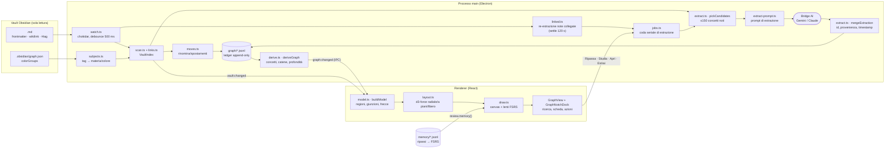

# Grafo concettuale di Sinapsi

Documento basato sul codice del branch `feat/ui-fixes-r5`. Ogni affermazione rimanda al modulo che la implementa. Dove una funzionalità non esiste viene detto esplicitamente (§1.8).

> **Premessa che cambia tutto il resto.** Il grafo di Sinapsi **non** è il grafo di Obsidian. I nodi non sono note e gli archi non sono wikilink. I nodi sono **proposizioni vere** (definizioni, teoremi, lemmi, criteri) estratte da un modello AI dal testo delle note; gli archi sono **catene di implicazione** ("queste premesse, insieme, implicano questa conclusione"). Wikilink, tag e frontmatter servono a *orientare* l'estrazione e a disegnare il contesto, non a definire i concetti.

---

## 1. Architettura e funzionamento tecnico

### 1.1 Pipeline end-to-end

| Stadio | Modulo | Cosa produce |
|---|---|---|
| Ingestione | `src/main/vault/scan.ts`, `links.ts`, `subjects.ts` | `VaultIndex`: una `VaultNote` per file `.md` |
| Osservazione | `src/main/vault/watch.ts`, `linked.ts`, `src/main/graph/moves.ts` | Eventi di modifica, re-estrazioni mirate, record di spostamento |
| Estrazione | `src/main/graph/jobs.ts`, `extract.ts`, `extract-prompt.ts` | Righe `prop`, `chain`, `extraction` |
| Persistenza | `src/main/graph/store.ts` | 4 file JSONL append-only |
| Derivazione | `src/main/graph/derive.ts` | `GraphData` (`concepts`, `chains`, `extracted`) |
| Modello vista | `src/renderer/src/graph/model.ts` | `GraphModel` (regioni, giunzioni, frecce, note, wikilink, frontiera) |
| Layout e disegno | `layout.ts`, `draw.ts` | Posizioni d3-force, canvas 2D |
| Interazione | `GraphView.tsx`, `GraphNotchDock.tsx` | Ricerca, lenti, scheda dettagli, azioni |

### 1.2 Ingestione dal vault

`scanVault()` (`scan.ts`) visita ricorsivamente il vault, salta cartelle che iniziano con `.` e quelle escluse nelle impostazioni, legge fino a 16 file in parallelo. I placeholder iCloud (`.Nota.md.icloud`) restano nell'indice con `available: false`: compaiono, ma non si possono estrarre.

Per ogni nota (`VaultNote`, `src/shared/vault-types.ts`):

| Campo | Sorgente | Uso nel grafo |
|---|---|---|
| `title` | nome file senza `.md` | etichetta della regione, risoluzione link |
| `tags` | frontmatter `tags` + `#tag` inline (fuori dal codice) | determina `subject` |
| `subject` | primo tag che coincide con un `colorGroup` di `.obsidian/graph.json` (`subjects.ts`) | colore/cluster, selezione dei candidati, priorità in background |
| `aliases` | frontmatter `aliases` | risoluzione dei wikilink |
| `type` | frontmatter `Type`/`type` | riconoscimento dei MOC |
| `verifica` | frontmatter `Verifica` (`ok`/`dubbi`/`errori`) | non usato dal grafo |
| `links` | `parseWikilinks()` (`links.ts`) | candidati, re-estrazione, archi nota↔nota |
| `headings`, `blockIds` | regex sul corpo | non usati dal grafo |

**Parsing dei wikilink** (`links.ts`): riconosce `[[Nota]]`, `[[Cartella/Nota]]`, `[[Nota#Titolo]]`, `[[Nota#^blocco]]`, `[[Nota|alias]]` (anche `\|` nelle tabelle) e gli embed `![[…]]`. Ignora tutto ciò che sta in blocchi di codice e gli allegati (immagini, PDF, audio, `.canvas`, `.excalidraw`…).

**Risoluzione** (`scan.ts`, fondo del file): per titolo, poi per alias, case-insensitive. Con titoli duplicati vince la cartella scritta nel link, poi la cartella più vicina alla nota che linka, poi il percorso più corto. I link non risolti restano con `resolved: false`.

### 1.3 Estrazione di entità e relazioni

L'estrazione è **progressiva**: una nota alla volta, in una coda seriale (`createExtractor`, `jobs.ts`). Non esiste una scansione "tutto il vault in un colpo".

**Quando parte**

| `reason` | Innesco | Se il testo non è cambiato |
|---|---|---|
| `manual` | pulsante "Estrai i concetti" / "Estrai di nuovo" nella scheda del grafo | estrae comunque |
| `study` | una *nota viva* diventa `ready` (`ipc.ts`, `notesUpdated`) | salta |
| `linked` | una nota collegata (via wikilink, in entrambe le direzioni) è stata modificata in Obsidian | estrae comunque |
| `background` | timer ogni 10 min, se il Mac è inattivo da ≥300 s e `backgroundExtraction` è attivo | registra `skipped: true`, non conta nel limite |

Il background estrae al massimo `dailyExtractionLimit` note al giorno (default **6**, max 50; `settings-schema.ts`), solo note con una nota viva pronta (`eligible`), non ritenta in giornata una nota fallita, e ordina per priorità: materie in studio → note linkate da note già estratte → resto, alfabetico. Una nota è "stale" se mai estratta o con `mtime` successivo all'ultima estrazione. Durante la chiamata AI il sistema blocca la sospensione (`powerSaveBlocker`).

**Il prompt** (`extract-prompt.ts`) chiede al modello:
- le **idee portanti** (definizioni, teoremi, lemmi, criteri, conseguenze), escludendo esempi, glosse di notazione e numerazione;
- per ognuna `name` (≤ 6 parole), `statement` autosufficiente con LaTeX `$…$`, `section` della nota;
- le **catene**: insiemi di premesse che *insieme* implicano una conclusione. Legami storici o narrativi non sono catene; argomenti indipendenti per la stessa conclusione sono catene separate;
- solo affermazioni vere sul mondo: un errore comune entra come la sua correzione.

**Deduplicazione tra note.** Prima della chiamata, `pickCandidates()` (`extract.ts`) passa al modello fino a 150 concetti già nel grafo, in quest'ordine: concetti della nota stessa → concetti di note che questa linka → concetti di note che linkano questa → concetti della stessa materia ordinati per parole in comune. Se un'idea della nota *è* uno di questi (anche parafrasata), il modello risponde `{ "ref": "n_…" }` invece di crearne una nuova. È qui che i **wikilink contano davvero**: determinano quali concetti esistenti il modello vede e quindi può riconoscere.

**Merge deterministico** (`mergeExtraction`): il modello decide *cosa* sono le idee; id (`n_<12 hex>`, `arg_<12 hex>`), provenienza e timestamp li assegna il codice. Ogni elemento è validato singolarmente con Zod: quelli malformati, i `ref` a id inesistenti, le catene autoreferenziali o con premesse irrisolte vengono scartati e contati in `dropped`, senza far fallire l'estrazione.

### 1.4 Modello dati

**Persistenza** (`store.ts`) in `~/Library/Application Support/Sinapsi/graph/` (o `$SINAPSI_DATA/graph/`):

| File | Riga | Contenuto |
|---|---|---|
| `propositions.jsonl` | `PropLine` | `id`, `name`, `statement`, `notePath`, `section?`, `at` |
| `chains.jsonl` | `ChainLine` | `id`, `premises[]`, `conclusion`, `notePath`, `at` |
| `extractions.jsonl` | `ExtractionLine` | `notePath`, `hash` SHA-256, `reason`, conteggi, `ok`, `skipped?`, `error?` |
| `moves.jsonl` | `MoveLine` | `from`, `to`, `at` |
| `positions.json` | mappa `id → [x, y]` | posizioni dei nodi (non ledger; max 20 000 voci) |

I ledger sono **append-only**: nulla viene mai riscritto o cancellato. Il grafo è sempre ricostruito da zero a ogni lettura.

**Derivazione** (`deriveGraph`, `derive.ts`, funzione pura):

1. **Spostamenti**: ogni riga segue, in ordine, le `moves` registrate dopo di essa (anche transitivamente; una rinomina e il suo annullamento si compensano).
2. **Concetti** (`Concept`): righe `prop` con lo stesso `id` confluiscono in un nodo. `birth` = prima nota; `notes` = tutte le note in cui compare; `sections` = sezione per nota; `aliases` = enunciati alternativi.
3. **Catene** (`Chain`): scartate se una premessa o la conclusione non esiste; deduplicate per chiave `premesse ordinate > conclusione`, unendo le note di provenienza.
4. **Profondità di inferenza** (`depth`): lunghezza del cammino di premesse più lungo verso il nodo. I cicli sono collassati con l'algoritmo SCC di Tarjan, così i membri di un ciclo condividono la profondità. `depth = 0` → **base**.
5. **`extracted`**: per ogni nota, hash e timestamp dell'ultima estrazione riuscita.

Funzione accessoria: `ancestors(g, id)` restituisce tutti i concetti su cui un nodo poggia transitivamente.

Il grafo **non ha pesi sugli archi**. L'unica grandezza numerica intrinseca è `depth`; le metriche di memoria arrivano da FSRS (§1.7).

### 1.5 Aggiornamento alla modifica delle note

| Evento in Obsidian | Effetto |
|---|---|
| Salvataggio di una nota | `watch.ts` raccoglie i `.md` cambiati (debounce 500 ms) → nuova `VaultIndex` → broadcast `vault:changed` |
| Nota con nota viva modificata | `linked.ts` attende **120 s** di quiete (le automazioni del vault scrivono più volte), confronta l'hash del corpo **senza frontmatter**; se cambiato rigenera la nota viva, che a sua volta innesca l'estrazione `study` |
| Note collegate a quella modificata | re-estratte con `reason: 'linked'` se hanno una nota viva. I **MOC** (`type: MOC`) né propagano né ricevono, altrimenti un link aggiunto a un MOC toccherebbe tutto il corso |
| Rinomina/spostamento | `detectMoves()`: stesso hash di contenuto o, in mancanza, stesso titolo in un'altra cartella (match univoco) → riga in `moves.jsonl`; i concetti seguono la nota. All'avvio `detectOfflineMoves()` recupera le rinomine fatte ad app chiusa |
| Fine di un'estrazione | broadcast `graph:changed` con il nuovo `GraphData`; durante l'esecuzione viene inviato solo lo stato della coda. Al termine parte anche `review.prepare()` per preparare le domande di Ripasso di quella nota |

Una modifica al solo frontmatter (es. `Verificata:` scritto dal controllo di correttezza) **non** innesca la riscrittura della nota viva (`body-hash.ts`). L'estrazione manuale/background usa invece l'hash del testo completo.

### 1.6 Rendering e navigazione UI

**Modello vista** (`buildModel`, `model.ts`):
- **Regione** = una nota in cui sono *nati* concetti; colore stabile derivato dall'hash FNV del percorso.
- **Giunzione** = nodo intermedio per le catene con ≥ 2 premesse (premesse → giunzione → conclusione, freccia solo sull'ultimo tratto). Le catene a premessa singola sono una freccia diretta.
- **Note Obsidian non estratte**, **wikilink** nota↔nota (deduplicati, non orientati) e **frontiera** (link non risolti dentro i MOC: note citate ma non ancora scritte).

> **Nelle viste attuali il grafo è filtrato.** `Home.tsx` e `MapView.tsx` passano sempre `livePaths` (note con nota viva `ready`). `liveOnly()` tiene solo i concetti presenti in quelle note, le catene interne a quell'insieme, solo i link risolti e **nessuna frontiera**. Le note mai studiate non compaiono.

**Layout** (`layout.ts`, d3-force):

| Modalità | Disposizione |
|---|---|
| Radiale (default) | basi al centro, raggio = `90 + depth·62`; anelli di profondità; cerchio tratteggiato "limite di ciò che sai" |
| A piani | basi in basso, conseguenze in alto: le frecce salgono |
| Libero | forze senza vincoli di profondità |

Le posizioni sono salvate in `positions.json` e riusate: un nuovo concetto non rimescola il grafo.

**Codifica visiva dei concetti** (`draw.ts`):

| Segno | Significato |
|---|---|
| Pieno verde / giallo / rosso | stato FSRS `la sai` (R ≥ 0,85) / `incerto` (R ≥ 0,60) / `debole` |
| Vuoto, bordo col colore della regione | mai ripassato |
| Anello tratteggiato | il concetto compare in più note (un nodo solo) |
| Alone caldo | in scadenza (`due ≤ ora`) |
| Etichetta di regione | `N concetti · R medio %` |

**Lenti** (dock, sezione "Evidenzia concetti", con anelli percentuali): *Tutto*, *Da ripassare*, *Mai visti*, *Basi fragili* (concetti `incerto`/`debole` da cui dipendono, direttamente o no, ≥ 3 concetti; `fragileBases()`). I nodi fuori lente scendono al 12 % di opacità.

**Scheda dettagli** (click su un nodo):

| Selezione | Mostra | Azioni |
|---|---|---|
| Concetto | livello, stato FSRS e R %, enunciato (LaTeX), note e sezioni in cui compare, **Segue da** (premesse dirette), **Porta a** (conclusioni dirette) | **Cosa serve per capirlo (n)** → evidenzia il concetto e tutti i suoi antenati; **Ripassa**; **Apri la nota** (nota di nascita) |
| Regione | concetti nati qui con livello, concetti presi da altre note, wikilink scritti in Obsidian | **Studia questa nota**, **Ripassa questa nota**, **Apri la nota**, **Estrai di nuovo** |
| Nota non estratta | stato (non scaricata da iCloud / estratta senza concetti / da estrarre) | **Estrai i concetti**, **Apri la nota** |

Ricerca (testo o dettatura) su nome ed enunciato dei concetti, titoli di regioni e note, senza accenti; `Esc` chiude la selezione.

### 1.7 Dialogo con gli altri moduli

| Modulo | Come usa il grafo | File |
|---|---|---|
| **FSRS / memoria** | Lo stato non è salvato: ogni concetto ha una carta FSRS ricostruita riproducendo i suoi ripassi (`ts-fsrs`, FSRS-6 con giorni frazionari). Chiave: `conceptId` del grafo | `src/main/memory/fsrs.ts`, `src/shared/memory-types.ts` |
| **Ripasso** | Piani per id, per "i più deboli", per misconcezioni; i concetti nuovi entrano in ordine di `depth` crescente (prima le basi) | `src/main/memory/review.ts` |
| **Suggerimenti in Home** | Chip "Ripasso del giorno" (concetti in scadenza); chip **base fragile**: concetto con R < 0,6 che è premessa diretta di ≥ 2 conclusioni, ordinato per numero di conclusioni; chip "sbagliato con sicurezza" | `src/main/suggest/suggest.ts` |
| **Sessioni di studio (tutor AI)** | `resolveGoals()` trova i concetti obiettivo dal titolo; `minimalTree()` prende obiettivi + **tutti** gli antenati e pota quelli `la sai` con stabilità ≥ `solidDays` (default 14 g); il tutor riceve anche `memoryBrief()`: fino a 40 concetti della nota, basi prima, con R, S, ultimo voto, ripassi, dimenticanze, misconcezioni | `src/main/session/minimal-tree.ts`, `memory-brief.ts`, `runner.ts` |
| **Report lezioni** | Mappa i concetti delle lezioni ai concetti Sinapsi estratti dalla nota corrispondente; padronanza = R medio | `src/main/tutor/sinapsi-tutor.ts` |
| **Calibrazione** | Materia di un concetto = `subject` della sua nota di nascita | `src/main/ipc.ts` (`reviewCalibration`) |
| **Apertura note** | `onOpenNote(path)` → `onOpenSource` del renderer | `Home.tsx`, `MapView.tsx` |

### 1.8 Cosa NON c'è (o è solo predisposto)

| Voce | Stato nel codice |
|---|---|
| Archi derivati dai wikilink | No. I wikilink sono disegnati come archi *nota↔nota* di contesto; gli archi tra concetti vengono solo dalle catene AI |
| Pesi sugli archi | No |
| Rilevamento esplicito di "nodi orfani" | No. Un concetto isolato si riconosce visivamente: livello 0 senza voce "Porta a". La lente *Mai visti* e *Basi fragili* sono gli unici filtri diagnostici |
| Interrogare il tutor sul vicinato di un nodo (1-2 hop) | **Non esiste** un pulsante "chiedi all'AI su questo nodo". Il contesto passato al tutor è l'albero degli antenati (non un vicinato a raggio fisso) e il brief di memoria della nota |
| Tag come nodi | No. I tag servono solo a determinare la materia |
| Frontiera e note non estratte nella vista | Calcolate da `buildModel`, ma nascoste in `Home`/`MapView` perché entrambe passano `livePaths` |
| `GraphExercise.tsx` | Non riguarda il grafo concettuale: è l'esercizio "Sul grafico" su figure di funzioni |
| Coerenza regola MOC | `linked.ts` riconosce un MOC solo da `type: MOC`; `shared/moc.ts` (usato dalla vista e dai suggerimenti) anche dal titolo che finisce con `MOC` o dal tag `moc`/`mocs` |

---

## 2. Applicazioni pratiche nello studio

### 2.1 Tabella di sintesi

| Meccanica del grafo | Problema di studio | Azione pratica |
|---|---|---|
| Catene premesse → conclusione, `depth` | Non so da quale prerequisito nasce la difficoltà su un teorema | Seleziona il teorema → **Cosa serve per capirlo**: si accende l'intero albero degli antenati; scendi verso il centro finché trovi il primo nodo rosso/giallo o vuoto |
| Lente **Basi fragili** + chip "base fragile" | Ripasso a caso e le dimostrazioni avanzate continuano a crollare | Ripassa prima le basi segnalate: ogni ripasso riuscito su una base sostiene ≥ 3 concetti a valle |
| Colore FSRS, lente **Da ripassare**, R medio per regione | A una settimana dall'esame non so quali capitoli sono a rischio | Leggi le etichette di regione (`N concetti · R %`) e ripassa le regioni con R più basso; "Ripassa questa nota" lancia il ripasso solo su quei concetti |
| Lente **Mai visti**, nodi vuoti | Ho studiato la nota ma non ho mai verificato di ricordarla | Lancia "Ripassa questa nota": i concetti nuovi entrano per profondità crescente |
| Anello tratteggiato (concetto in più note) | Non vedo che lo stesso risultato torna in corsi diversi | Apri la scheda: "Compare in N tue note" con la sezione esatta di ciascuna |
| Albero minimo nella sessione | Il tutor rispiega cose che so già | Avvia **Studia questa nota**: gli antenati solidi (`la sai`, S ≥ 14 g) vengono potati, il tutor parte dalle basi deboli |
| Regioni e "Segue da / Porta a" | Ripassare senza aprire la nota | Usa il grafo come mappa muta (§2.4) |

### 2.2 Mappatura delle dipendenze logiche

**Analisi Matematica — esempio coperto anche dalle fixture di test** (`src/main/graph/fake-extract.ts`): dalla nota "Teorema di Rolle" escono *Teorema di Weierstrass* e *Teorema di Fermat* come premesse e *Teorema di Rolle* come conclusione (una catena a due premesse → una giunzione). Dalla nota "Teorema di Lagrange" il modello riconosce Rolle come concetto già esistente (`ref`) e crea la catena Rolle → Lagrange.

Risultato nel grafo radiale: Weierstrass e Fermat al livello 0, Rolle al livello 1, Lagrange al livello 2. Se Lagrange è rosso:

1. Seleziona *Teorema di Lagrange* → **Cosa serve per capirlo (3)**.
2. Il percorso evidenziato mostra Rolle, Weierstrass, Fermat. Se Rolle è giallo e Fermat rosso, la lacuna è in Fermat (condizione necessaria del primo ordine), non in Lagrange.
3. **Ripassa** su Fermat, poi risali.

Lo stesso schema vale per **Algebra Lineare** (teorema del rango ← definizione di nucleo e immagine ← applicazione lineare) e **Programmazione** (correttezza di un algoritmo ricorsivo ← invariante ← induzione strutturale). Funziona solo se la nota *argomenta* le dipendenze: il prompt ignora legami narrativi ("poi vediamo…") e crea catene solo per implicazioni.

### 2.3 Diagnosi dei punti deboli prima di un esame

Procedura con quello che c'è oggi:

1. **Dock → Evidenzia concetti → Basi fragili.** Restano accesi solo i concetti `incerto`/`debole` con ≥ 3 discendenti. Sono la priorità assoluta: un R basso su una base abbassa la tenuta di tutto ciò che vi poggia.
2. **Da ripassare.** Concetti con `due` scaduto (alone caldo). L'anello del dock dice la percentuale sul totale.
3. **Etichette di regione.** L'R medio per nota individua i capitoli a rischio.
4. **Concetti isolati.** Non c'è un filtro dedicato. In modalità radiale cerca nodi al livello 0 senza frecce uscenti; nella scheda mancano "Porta a" e compare "È una base". Di solito indicano una nota che *enuncia* senza *collegare*: aggiungi alla nota un paragrafo che dica da cosa segue o a cosa serve e usa **Estrai di nuovo**.
5. In Home il chip **base fragile** fa lo stesso calcolo in automatico e propone il singolo concetto più critico.

### 2.4 Richiamo attivo strutturale (mappa muta)

Sul canvas i nomi brevi dei concetti compaiono solo da zoom ≈ 1,15× in su (`tProp` in `draw.ts`); sotto quella soglia i concetti sono punti colorati con le sole etichette di regione. Gli enunciati compaiono solo nella scheda. Questo rende il grafo utilizzabile come mappa muta a due livelli.

1. Modalità **A piani** (le frecce salgono dalle basi), zoom basso: per ogni regione ricostruisci quali concetti contiene e come si collegano; poi avvicinati per controllare i nomi.
2. Zoom alto, senza cliccare, per ogni nodo di livello ≥ 1: enuncia ad alta voce il risultato e spiega *perché* le sue premesse lo implicano. Per una giunzione, spiega perché servono **tutte** le premesse (es. Rolle senza Weierstrass non garantisce l'esistenza dell'estremo).
3. Per i nodi con anello tratteggiato, ricostruisci in quali corsi compaiono e con quale ruolo.
4. Solo dopo, clicca: confronta con l'enunciato e con "Segue da / Porta a". Se sbagli, **Ripassa** dalla scheda registra l'esito in FSRS.
5. Ripeti a livello di regione: per due regioni collegate da un wikilink, spiega quali concetti dell'una servono all'altra; la scheda di regione elenca i "presi da altre note".

### 2.5 Contestualizzazione mirata per l'AI Tutor

Stato reale: Sinapsi **non** ha un comando che invia al tutor il vicinato a 1-2 hop di un nodo. Esistono tre canali di contesto automatici e un flusso manuale.

**Automatico**
- **Sessione di studio** ("Studia questa nota"): il tutor riceve l'**albero minimo** (obiettivi + tutti gli antenati, potati quelli solidi) e il **brief di memoria** dei concetti della nota. Il contesto è quindi l'intera catena dei prerequisiti non consolidati, non un raggio fisso.
- **Estrazione**: il modello vede i concetti delle note collegate per riconoscere i duplicati.
- **Ripasso**: le domande sono generate per i concetti selezionati, con le debolezze attive.

**Manuale (vicinato a 1-2 hop)**
1. Seleziona il concetto: la scheda mostra il vicinato a 1 hop ("Segue da", "Porta a").
2. Clicca una premessa per vederne a sua volta le premesse (2° hop).
3. Formula la domanda citando i nodi per nome e la relazione, ad esempio: *"Nel teorema di Lagrange applico Rolle alla funzione ausiliaria g(x) = f(x) − mx. Quale ipotesi di Rolle verifico con f(a) = f(b) per g, e perché senza Weierstrass non posso concludere?"* invece di *"spiegami Lagrange"*.

Un pulsante "Chiedi al tutor su questo nodo" che serializzi premesse, conclusioni ed enunciati sarebbe un'estensione naturale di `Card` in `GraphView.tsx`, ma oggi non c'è.

---

## 3. Workflow operativo rapido

Checklist per note Obsidian che producono un grafo utile senza formattazione aggiuntiva:

1. **Un tag di materia mappato in `graph.json`.** In Obsidian, *Graph view → Groups*, crea un gruppo `tag:#analisi1` con un colore e metti `#analisi1` (nel frontmatter `tags` o inline) in ogni nota del corso. Senza, `subject` resta `null`: niente colore di materia, niente candidati "stessa materia" per la deduplicazione, nessuna priorità in background.
2. **Wikilink ai prerequisiti, nel testo che argomenta.** Scrivi "per il [[Teorema di Rolle]] applicato a g…" invece di elencare link in fondo. I link decidono quali concetti esistenti il modello vede (e quindi riusa invece di duplicare) e quali note vengono re-estratte quando ne modifichi una.
3. **Argomenta le implicazioni in modo esplicito.** Enunciato, ipotesi, "da A e B segue C". Il prompt estrae catene solo da implicazioni; esempi e note storiche vengono ignorati. Usa titoli di sezione (`## §2 Enunciato`): finiscono in `section` e la scheda indica dove rileggere.
4. **MOC con `type: MOC` nel frontmatter.** Così la regola di `linked.ts` li esclude dalla propagazione (con il solo titolo "… MOC" la vista li riconosce, la sincronizzazione no) e i link non risolti al loro interno alimentano la frontiera.
5. **Crea la nota viva, poi lascia lavorare il sistema.** L'estrazione automatica (`study`, `linked`, `background`) riguarda solo le note con nota viva pronta, e la vista mostra solo quelle. Dopo una modifica sostanziale, se non vuoi attendere i 120 s di quiete o il ciclo in background, usa **Estrai di nuovo** dalla scheda della regione.

---

### Riferimenti ai sorgenti

- Vault: `src/main/vault/scan.ts`, `links.ts`, `subjects.ts`, `watch.ts`, `linked.ts`, `body-hash.ts`; tipi in `src/shared/vault-types.ts`, `src/shared/moc.ts`
- Grafo (main): `src/main/graph/jobs.ts`, `extract.ts`, `extract-prompt.ts`, `derive.ts`, `store.ts`, `moves.ts`, `fake-extract.ts`; tipi in `src/shared/graph-types.ts`
- IPC: `src/main/ipc.ts`, `src/main/ipc-handlers.ts` (`makeGraphHandlers`), `src/preload/index.ts`
- Grafo (renderer): `src/renderer/src/graph/model.ts`, `layout.ts`, `draw.ts`, `GraphView.tsx`, `GraphNotchDock.tsx`; montaggio in `src/renderer/src/home/Home.tsx`, `src/renderer/src/shell/MapView.tsx`
- Integrazioni: `src/main/memory/fsrs.ts`, `review.ts`, `src/main/suggest/suggest.ts`, `src/main/session/minimal-tree.ts`, `memory-brief.ts`, `runner.ts`, `src/main/tutor/sinapsi-tutor.ts`; impostazioni in `src/shared/settings-schema.ts`
- Prototipo e piani: `docs/prototipi/grafo-v2.html`, `docs/superpowers/plans/2026-10-27-fase4a-grafo.md`
