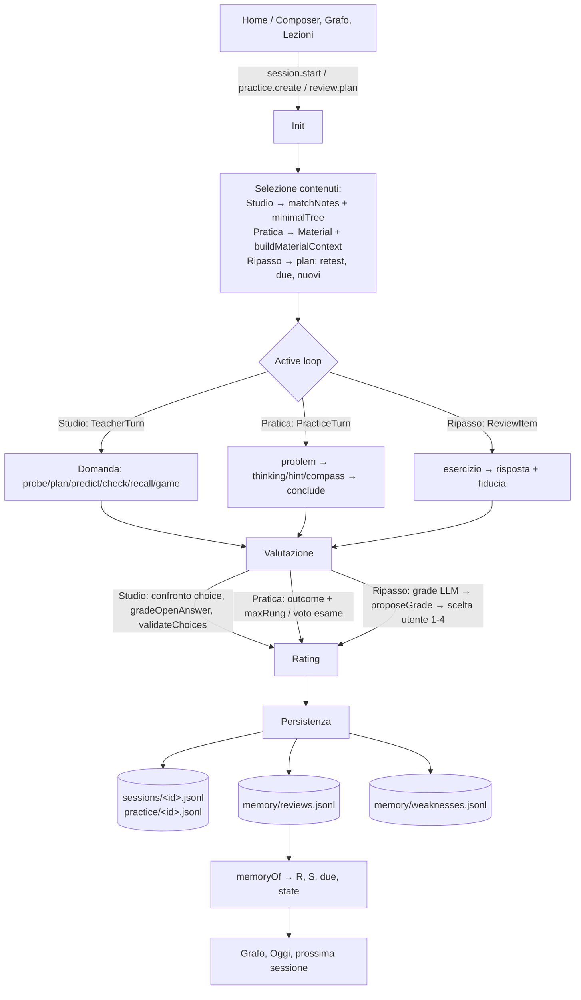

# Sessioni di Studio, Pratica e Ripasso

> Documentazione tecnica ricavata dal codice del branch `feat/concept-graph` (ultimo commit `e8b18f7`, novembre 2026).
> Ogni affermazione rimanda a file e simboli reali. Ciò che è parziale o incoerente è raccolto nella §5.
>
> **Nota sul nome.** Nel codice e nella UI la "Sessione di Studio" si chiama **Apprendimento** (`Composer.tsx`: `MODES = ['Apprendimento', 'Pratica', 'Ripasso']`, chiave `learn`). Il backend la chiama *session* (`src/main/session/*`). In questo documento "Studio" e "Apprendimento" indicano la stessa cosa.
>
> **Nota su `session_analysis.md`.** Quel documento (alla radice, scritto su `b389b16`) è **superato** su punti centrali: sostiene che la sessione non scrive nel log FSRS e che il piano è scollegato dal grafo. Il commit `a384bba` ("padronanza deterministica, correttore separato, FSRS di sessione") ha cambiato entrambe le cose. Qui vale il codice attuale.

---

## 1. Panoramica architetturale

### 1.1 Il ciclo di apprendimento

Le tre modalità condividono quattro risorse; nessuna ha uno stato proprio di "padronanza" persistito a parte:

| Risorsa | Dove vive | Chi la scrive | Chi la legge |
|---|---|---|---|
| **Note Obsidian** | vault (`settings.vaultPath`), indicizzato da `src/main/vault/*` | l'utente (e "note vive", `src/main/notes/generator.ts`, file separati) | Studio (nota abbinata), Pratica (note dei concetti scelti), Ripasso (generazione varianti, "Spiegalo tu") |
| **Concept Graph** | `dataDir()/graph`, `GraphData` (`src/shared/graph-types.ts`) derivato da `src/main/graph/derive.ts` | l'estrattore (`extractor`) dalle note | Studio (`minimalTree`), Pratica (`buildMaterialContext`, `buildCatalog`), Ripasso (`plan`, esercizi `chain`) |
| **Motore FSRS** | `dataDir()/memory/reviews.jsonl` (`ReviewLine`), stato ricostruito da `memoryOf()` in `src/main/memory/fsrs.ts` | **tutte e tre** le modalità (`via: 'session' \| 'practice' \| 'review'`) | tutte e tre + Grafo, Home, Oggi, Nota (`review.memory()`) |
| **Debolezze** | `dataDir()/memory/weaknesses.jsonl` (`WeaknessLine`) | Studio e Pratica | Studio (`minimalTree`), Pratica (contesto), Ripasso (varianti mirate) |
| **AI Tutor** | CLI esterne via `src/main/ai/bridge.ts` (`converse` multi-turno, `ask` singola) | — | Studio (`task: 'teach'` + `grade`), Pratica (`teach`), Ripasso (`variants`, `grade`) |

Principio comune: **event sourcing**. Nessuno stato di sessione o di memoria è salvato come snapshot; tutto è un `fold` di righe JSONL append-only (`appendJsonl`/`readJsonl`, `src/main/store/jsonl.ts`):

- Studio: `reduceSession(events)` (`src/main/session/events.ts`)
- Pratica: `reducePractice(events)` (`src/main/practice/events.ts`)
- Memoria: `memoryOf(reviews, now)` rigioca ogni `ReviewLine` per concetto con `ts-fsrs` (`replay()`)

La "padronanza" di un nodo nel grafo **non** è un campo del grafo: `GraphView.tsx` chiama `window.sinapsi.review.memory()` e colora i nodi con `Memory.state` / `Memory.R`. Ogni modalità influenza quindi il grafo solo scrivendo `ReviewLine` (e `WeaknessLine`).

### 1.2 Ciclo di vita generico



Trasporto UI ↔ main: canali IPC in `src/main/ipc.ts` esposti da `src/preload/index.ts` come `window.sinapsi.session | practice | review`. Studio e Pratica sono asincroni: gli handler ritornano subito (`background(...)`) e lo stato arriva via broadcast `session:updated` / `practice:updated` (più `session:partial` per lo streaming del campo `md`). Il Ripasso è sincrono request/response.

---

## 2. Matrice comparativa

| | **Studio (Apprendimento)** | **Pratica** | **Ripasso** |
|---|---|---|---|
| **Obiettivo cognitivo** | Acquisizione ed elaborazione guidata di un argomento fino alla padronanza degli obiettivi (metodo socratico, `teacherSystemPrompt`) | Richiamo generativo in situazioni nuove: problem solving, discriminazione, composizione (`PRACTICE_MODES = recall \| discrimination \| composition`) | Spaced repetition algoritmica sui singoli concetti |
| **Trigger di avvio** | Composer modo *Apprendimento* (`api.session.start(text)`), "Tutor dal nodo" nel grafo (`App.tsx` `askTutor` → `start(name, { goalIds: [conceptId] })`), suggerimento "sessione da finire" | Composer modo *Pratica* → `PracticeSetup` (`practice.create(material)` o `practice.examStart(material, minutes, paper)`), grafo (`onOpenPracticeSetup`), Lezioni (`nextMode: 'practice'`) | Composer modo *Ripasso* (badge `due`), grafo (`onReview([id], { cascadeWeak })`, "Massimo guadagno" `order: 'gain'`), clinica misconcezioni (`misconceptions: true`), Lezioni |
| **Selezione item** | `matchNotes()` (titolo/alias, ≤3 candidati) → `resolveGoals()` → `minimalTree()` = obiettivi + antenati, potati se `la sai` con `S ≥ solidDays` | Scelta esplicita in `MaterialDialog` (concetti `≤ PRACTICE_MAX_CONCEPTS = 4`, fonti notebook, testo libero) con suggerimenti `buildCatalog().suggested`; i problemi li genera il tutor | `ReviewService.plan()`: retest misconcezioni (1–3 giorni), poi `due` per R crescente, poi ≤ `NEW_PER_SESSION = 5` nuovi per `depth`; taglio a `reviewSessionSize` (default 12); `interleave()` per nota; + esercizi `chain` |
| **Interazione** | Conversazione a turni `TeacherTurn` / `LearnerAnswer`: scelta (A–F + fiducia + ragionamento), aperta, gioco (`speed/match/order/spot/taboo`), testo libero sul piano | Un problema alla volta (`problem`), tentativi (`thinking`, anche da foto), scala di indizi a 6 gradini (`RUNG_IT`), Bussola della confusione (`compass`), riformulazione (`restate`), `dismiss`/`next`/`end`; oppure simulazione d'esame a tempo (anche su carta) | Esercizio da variante pre-generata (12 tipi `EXERCISE_TYPES`), slider fiducia, correzione, scelta del voto 1–4 con intervalli previsti |
| **Ruolo dell'AI** | Tutor conversazionale (`converse`, `task: 'teach'`) + correttore indipendente per aperte/Tabù (`gradeOpenAnswer`, motore "altro" di default) + audit a fine sessione delle scelte (`validateChoices`) | Tutor conversazionale (`converse`, `task: 'teach'`) che propone, dà indizi e **dichiara l'esito**; in esame genera il compito e lo corregge (`bridge.ask`, `task: 'teach'`) | Generatore offline di varianti (`task: 'variants'`), correttore singolo (`task: 'grade'`), studente pignolo "Spiegalo tu" (`explain`) |
| **Dati salvati** | `sessions/<id>.jsonl`, a fine sessione `sessions/index.jsonl`, `ReviewLine{via:'session'}` (≤1 per concetto), `WeaknessLine{source:'session'}` | `practice/<id>.jsonl`, `ReviewLine{via:'practice', ref:'train:…'\|'exam:…'}` per ogni target, `WeaknessLine{source:'practice'}`, eventi lezione | Solo `ReviewLine` (via assente = review), `variants.jsonl`, `explain-checked.jsonl` |
| **Impatto FSRS** | Scheduler dedicato `sessionScheduler` senza learning steps; grado da `sessionGrade()` | Scheduler standard; grado da `gradeFor(outcome, maxRung)` o quota punti esame | Scheduler standard; grado scelto dall'utente (proposto da `proposeGrade()`) |
| **Impatto Graph** | Indiretto via `memoryOf`; inoltre "Crea la nota viva" → nuova estrazione | Indiretto via `memoryOf`; `independentConcepts()` (`fading.ts`) usa le righe di pratica | Indiretto via `memoryOf` |

---

## 3. Anatomia delle tre modalità

### 3.1 Sessione di Studio (Apprendimento)

**File principali.** `src/main/session/runner.ts` (`createSessionRunner`), `events.ts` (`reduceSession`, `checkTurnAgainst`, `stageInstruction`, `fsrsEvidence`), `minimal-tree.ts`, `note-match.ts`, `prompt.ts`, `grade.ts`, `memory-brief.ts`; protocollo `src/shared/teacher-protocol.ts`; UI `src/renderer/src/session/` (`SessionView`, `QuestionDock`, `AnswerCard`, `PlanMap`, `games/*`); punteggio `src/shared/score.ts`.

#### Flusso operativo

1. **`create(topic, goalIds?)`** (`createNow`): de-duplica richieste concorrenti con la stessa chiave `topic` (`pending`), calcola `matchNotes(index, topic, 3)` e scrive l'evento `created` con `candidates`, `learnerProfile`, `mastery` (`settings.mastery`, default `{ kOpen: 2, kChoice: 3, solidDays: 14 }`). Stato: `awaiting: 'confirm'`.
2. **Conferma della nota.** Con ≤1 candidato o `settings.fastStart` la conferma è immediata; altrimenti `SessionView` mostra i candidati e chiama `api.confirm(id, path | null)`.
3. **`confirmNow`**:
   - legge la nota, il grafo (`extractor.graph()`), `reviews.jsonl` e le debolezze attive;
   - obiettivi: `goalIds` espliciti (Tutor dal nodo) oppure `resolveGoals()` (parole ≥4 lettere del topic contro nome/alias dei concetti, top 3 per punteggio e `depth`; in mancanza, i concetti più profondi della nota);
   - `minimalTree(graph, goals, memories, weaknesses, { solidDays })`: obiettivi + `ancestors()`, potatura dei prerequisiti `la sai` con `stability ≥ solidDays`, `chains` interne, nodi ordinati base → derivati per `depth`, con `R`, `S`, `state`, `weaknesses`, `sections`;
   - scrive `confirmed { notePath, tree, prior }` (`prior` = stato di memoria iniziale per nodo);
   - costruisce il primo messaggio (`firstMessage`): `treeBrief(tree)` (tabella `id | nome | enunciato | ruolo | R | S | debolezze` + catene), le **sole sezioni della nota referenziate dai nodi** (`sectionText`), gli enunciati dei nodi nati in altre note; senza albero ricade su `memoryBrief()` e sulla nota intera (`capNote`, `NOTE_LIMIT = 60_000`, avviso se presente `%% verifica-inizio %%`);
   - aggiunge `(Giochi disattivati…)` se `settings.gamesInSessions === false`.
4. **Turno del tutor (`teacherTurn`)**: `bridge.converse({ task: 'teach', conversationId, resume, systemPrompt: teacherSystemPrompt(profile), schema: TeacherTurnSchema, jsonSchema, signal, onPartial, partialField: 'md' })`. Al prompt viene sempre accodato `stageInstruction(state)`: un blocco `[Stato sessione]` calcolato dall'app (fase, concetto corrente e stato, `chunkSize`, retest pendente, probe rimasti, padroneggiati, obiettivo, eventuale "probe freddo" sugli obiettivi già visti).
5. **Vincoli applicati dal codice** — `checkTurnAgainst(state, turn)` rifiuta: `done` se `!readyToFinish`; più di 3 `probe`; id di piano non presenti nell'albero e non `new:slug`; `check/predict/recall` senza `nodeId` quando c'è un albero; giochi se `turnsSinceGame < 2`. In caso di violazione si fa **un** secondo `converse` con la motivazione (vedi §5 per il limite).
6. **Risposta (`answer`)**: verifica `questionId === pendingQuestion.id`, scrive `learner { text: formatLearnerReply(q, a), answer, question }`. Se la domanda è `open` o un Tabù su un nodo dell'albero, chiama `gradeOpenAnswer()` contro `statement + sezione` del nodo, con motore `otherEngine()` se `settings.graderEngine === 'other'` (default); scrive `graded { verdict, hintsUsed, reason }` e passa al tutor `Verdetto del correttore: …`.
7. **Altri comandi**: `say` (testo libero solo senza domanda aperta o su domanda `plan`), `retry`, `contest` / `flag` / `peek` (escludono la domanda dall'evidenza), `cancel` (abort del turno in volo → `aborted`), `end` (`cancelled` + `finalize`).

#### Rendering e interazione con la nota

La sessione è **read-only sul vault**. Il testo della lezione arriva dai `blocks[].md` del tutor (markdown + KaTeX, `render-md.ts`, `RichText.tsx`), non dalla nota renderizzata. La nota abbinata è mostrata come riferimento (titolo); l'unico strumento di "estrazione" è post-sessione: a `phase === 'done'` `SessionView` offre `notes.create({ sessionId })`, che genera una nota viva usando `sessionDigest()` (`src/main/notes/prompt.ts`) e poi rilancia l'estrazione nel grafo.

Il dock (`QuestionDock.tsx`) raccoglie: opzione/“Non lo so”, fiducia (slider), ragionamento, "pensieri durante la lettura" (`thoughts`), testo aperto, dettatura (`MicButton`). I giochi aprono `GameDock` in modale. `PlanMap` disegna il piano; i nodi "fatti" sono `doneNodeIds`.

#### Stato di padronanza (deterministico)

In `reduceSession`, ogni risposta su una domanda con `nodeId` diventa `Evidence` (`kind: open | choice | game`). È **esclusa** se sbirciata, contestata, segnalata, invalidata da `validated { ok: false }`, oppure se aperta e mai giudicata dal correttore (salvo "Non lo so"). Per l'evidenza attiva sui nodi dell'albero:

- `ConceptProgress.status`: `unseen → probed | repairing → mastered`;
- risposta corretta → `openStreak++` o `choiceStreak++`; errata → streak a 0, `pendingRetest` sul concetto, e se fiducia ≥ 63 un `misconceptionHit`;
- `mastered` se `openStreak ≥ kOpen` o `choiceStreak ≥ kChoice`, oppure "cold": prior `la sai` con `S ≥ solidDays` e prima evidenza corretta;
- `chunkSize` (passi per blocco, comunicato al tutor): 1 se in riparazione o con debolezze, 3 se ultime due fiducie ≥ 63 o prior `la sai`, altrimenti 2;
- `readyToFinish` = tutti gli obiettivi `mastered` **e** `recallDone` (almeno una domanda `role: 'recall'`). Un `done` prematuro è riportato a `consolidate` già nel riduttore.

Senza albero (grafo vuoto) vale l'euristica di ripiego: un `check` corretto aggiunge il `nodeId` a `doneNodeIds`.

#### Criteri di completamento e chiusura

La sessione termina con un turno `phase: 'done'` (con `summary { learned, shaky, misconceptions }`, imposto da `TeacherTurnSchema`) accettato solo se `readyToFinish`, oppure con `end` (annullamento). Entrambi chiamano `finalize(id)`, che in background e in modo idempotente:

1. `validateChoices()` sulle domande a scelta/gioco (motore "altro", priorità `background`) → eventi `validated`;
2. `fsrsEvidence(state)` → una `ReviewLine` per concetto con `ref = session:<id>:<conceptId>` (deduplicata); vedi §3.3 per le regole;
3. `WeaknessLine` `misconception` da `misconceptionHits`, dai `graded` incorrect e dalle `summary.misconceptions` abbinate per nome a un nodo;
4. `weaknesses.resolveByEvidence()` per ogni evidenza corretta con fiducia ≥ 63;
5. riga in `sessions/index.jsonl` (`masteredIds`, `shakyIds`, `misconceptions`, `turns`, `durationMs`, `goalConceptIds`).

UI accessoria: punteggio "leggero" `sessionScore()` (10 pt per check giusto, +5 se fiducia ≥ 70, 5 pt per punto nei giochi, calibrazione = 100 − media |fiducia − esito|), solo visivo.

### 3.2 Sessione di Pratica

**File principali.** `src/main/practice/runner.ts` (`createPracticeRunner`, `gradeFor`), `events.ts` (`reducePractice`), `exam.ts` (`createExamService`, `normalizePoints`), `material.ts` (`buildCatalog`, `buildMaterialContext`), `prompt.ts` (`PRACTICE_SYSTEM_PROMPT`, `firstPracticeMessage`), `photo.ts`; protocollo `src/shared/practice-protocol.ts`, tipi `src/shared/practice-types.ts`; UI `src/renderer/src/practice/` (`PracticeSetup`, `MaterialDialog`, `PracticeView`, `ExamView`, `PaperExam`, `ConfusionCompassCard`, `PhotoButton`).

#### Selezione del materiale e generazione dei problemi

`Material = { conceptIds, sourceIds, free, lessonId? }`. `buildMaterialContext()` compone il contesto per il tutor: concetti scelti (`id | nome | enunciato`), catene che li toccano, stato di memoria (`state`, `R`, `S`, misconcezione), debolezze attive, note Obsidian di nascita (≤ 12 000 caratteri l'una, 40 000 in totale), segmenti delle fonti notebook (≤ 40 000), testo libero. I problemi **non** sono pre-generati: li propone il tutor turno per turno come `Problem { id, statement, mode, targets, modelSolution, lines? }`. La `modelSolution` è fissata prima di porre il problema e resta fuori dallo stato pubblico (`withoutSolution`) finché il problema non è concluso. I `targets` vengono filtrati su `material.conceptIds` ("un id indovinato diventerebbe un fantasma in memoria").

#### Tentativi, indizi e feedback

- `Submission.kind`: `start | thinking | hint | next | ask | dismiss | end | compass | restate`. `thinking` può includere `line` (problemi "trova l'errore") e `photoText` (trascrizione di un foglio fotografato, `photo.ts`).
- **Prima il tentativo** (`hintGate`): senza tentativi è concesso un solo indizio al gradino 0; il successivo richiede un `thinking`; dopo il primo tentativo un indizio richiede la **Bussola della confusione** (`compass { known, stuck, question }`). Un indizio con `rung ≥ 3` impone `restate` (riformulazione con parole proprie) prima di proseguire.
- `allowed()` nel runner applica queste regole lato main; `checkTurnAgainst()` (in `practice-protocol.ts`) valida il turno del tutor rispetto allo stato e alla richiesta (un solo problema aperto, id nuovi, `dismiss` ⇒ `conclude: surrendered`, `end` ⇒ `done`, `compass` ⇒ `hint`, indizi > 0 solo dopo un tentativo). Se il secondo tentativo viola ancora, il runner forza la resa su `dismiss` o lancia un errore.
- Feedback: i `blocks` del tutor; alla conclusione `conclude { outcome: solved | solved_hints | surrendered, verdict, miss?, retest }` e la soluzione modello diventa visibile. `paused: true` permette domande (`ask`) prima di `next`.

#### Rubrica di valutazione

- **Allenamento**: non c'è un correttore separato; l'esito è dichiarato dal tutor. `gradeFor()`: `solved → 3`, `solved_hints → 2` (o `1` se `maxRung ≥ 3`), `surrendered → 1`.
- **Simulazione d'esame** (`exam.ts`): `sheetPrompt` genera 2–8 problemi con `points` e `modelSolution`; `normalizePoints()` porta il totale a 30 in mezzi punti (resti maggiori). Bozze salvate come diff (`answers { final: false }`), consegna unica, consegna automatica a tempo scaduto (in `get`). `gradePrompt` chiede punti, commento e `miss` per esercizio; `total = min(30, round(Σ))`, `lode` se pieno su tutti. **Su carta** (`paper`): `handed` → soluzioni visibili → autovalutazione per problema (`self`, solo la prima conta) → trascrizione/foto → correzione; `calibration()` confronta `self` con i punti dell'AI.

#### Tracciamento degli errori

`MISSES = cue | discrimination | execution | careless | structural`. Alla conclusione `record()` scrive per ogni target una `ReviewLine { via: 'practice', ref: 'train:<id>:<problem>', rung: maxRung, miss, lessonId }` (idempotente per `ref`); `miss` `structural` → `WeaknessLine kind: 'misconception'`, `discrimination` → `kind: 'discrimination'`; `solved` senza indizi risolve le debolezze attive del concetto. In esame: `grade g = quota ≥ 1 → 3, ≥ 0.5 → 2, altrimenti 1`, `ref: 'exam:<id>:<problem>'` (nessuna `WeaknessLine`). Ganci con il Registro Lezioni: `onCompass` (`confusion-added`), `onSolved` (`confusion-resolved`), `onDone` (`digest-done`).

### 3.3 Sessione di Ripasso

**File principali.** `src/main/memory/review.ts` (`createReviewService`), `fsrs.ts` (`memoryOf`, `displayedR`, `previewIntervals`), `variants.ts`, `grade-prompt.ts`, `explain.ts`, `history.ts` (`reviewSessions`), `store.ts`; tipi `src/shared/memory-types.ts`, `exercise-schema.ts`, `retention.ts`, `cascade.ts`; UI `src/renderer/src/review/` (`ReviewView`, `ExerciseView`, `exercises/*`, `ConfidencePanel`).

#### Integrazione FSRS

- Libreria `ts-fsrs` con `generatorParameters({ enable_fuzz: false })` — **parametri di default, nessuna ottimizzazione per utente**. Uno scheduler separato `sessionScheduler` (`learning_steps: []`, `relearning_steps: []`) si applica alle righe `via: 'session'`.
- Nessuna card persistita: `replay()` ordina le righe per `at` e rigioca `scheduler.next(card, date, RATING[grade])`. Mappa voti: `1 Again`, `2 Hard`, `3 Good`, `4 Easy`.
- `Memory = { state, R, due, reps, lapses, lastAt, misconception, stability, lastGrade }`.
- **Retrievability**: `displayedR()` usa la curva FSRS-6 con giorni frazionari, `R = (1 + factor·t/S)^(−w20)`, `factor = 0.9^(−1/w20) − 1`; in (Re)Learning schiaccia `R ≤ 0.40` dopo "Di nuovo" e `≤ 0.75` dopo "Difficile".
- **Stati**: `stateOf(R)` → `la sai` (≥ 0.85), `incerto` (≥ 0.60), `debole` (< 0.60), `mai visto` (null).
- **Misconcezione**: ultima risposta errata con fiducia ≥ 70, oppure debolezza attiva sul concetto (se passate a `memoryOf`).
- `previewIntervals()` mostra cosa programmerebbe ciascun voto (`formatInterval`: "10 min", "4 giorni"…).

#### Coda di ripasso (`plan`)

Modalità di `plan(opts)`: default; `conceptIds` (cascata dal grafo); `weakest`; `misconceptions` (clinica); `order: 'gain'` con `examAt` (ordina per guadagno di R alla data d'esame per minuto, via `retrievabilityAt`). Default:

1. **retest**: ultima risposta errata con fiducia ≥ 70, tra 1 e 3 giorni fa;
2. **due**: `memory.due ≤ now`, per R crescente;
3. **nuovi**: concetti senza righe, per `depth` crescente, max `NEW_PER_SESSION = 5`;
4. taglio a `settings.reviewSessionSize`.

Per ogni concetto: tipi ammessi = `settings.exerciseTypes` ∩ `PACER_EXERCISE_TYPES[pacerType]` della lezione più recente; `ensureVariants()` genera le varianti mancanti per nota (max 3 in parallelo, una sola volta per avvio app); scelta della variante mai chiesta o meno recente, di tipo diverso dall'ultimo; "Spiegalo tu" ≤ 1 item ogni `EXPLAIN_SHARE = 4`; ripiego `fallbackExercise()` ("Senza guardare: che cosa dice «…»?"). Si aggiungono item `chain` per ogni catena aciclica con premesse e conclusione già ripassate. Ordine finale `interleave()` (nota diversa dalla precedente), salvo `conceptIds` e `gain`.

#### Scala di rating e aggiornamento

`ReviewView.check()` → `review.grade()` (verdetto `ok | partial | wrong` + feedback; su errore ripiega su `partial`, voto 2) oppure `review.explain()` (turni dello studente pignolo fino a `MAX_QUESTIONS`), oppure valutazione locale per i tipi chiusi. Il voto proposto è `proposeGrade()`: sbagliato o "Non lo so" → 1, parziale → 2, giusto con fiducia < 50 → 2, altrimenti 3. L'utente sceglie tra **Di nuovo / Difficile / Bene / Facile** (1–4; "Facile" mai proposto). `advance()` chiama `review.record({ conceptId, at, grade, confidence, correct, dontKnow, variantId, type, misconception })`, che appende la riga e restituisce la nuova `Memory` e gli intervalli. Gli item `chain` sono valutati per unità d'idea (`gradeChainIdeaUnits`: 0 → 1, < 50% → 2, altrimenti 3, mai oltre 3). La cascata (`cascadeWeak`) può accodare un nuovo `plan({ conceptIds })` sui prerequisiti deboli (`weakPrerequisites`, `src/shared/cascade.ts`).

#### Sincronizzazione con il Concept Graph

Non c'è un passaggio esplicito: il grafo rilegge `review.memory()` (che passa le debolezze attive a `memoryOf`) e ricalcola stati, frontiera e premesse sospette (`suspectPremises`). La cronologia del Ripasso (`reviewSessions()`) raggruppa le righe a meno di 30 minuti l'una dall'altra.

---

## 4. Modello dati, persistenza e stato

### 4.1 File su disco

Radice: `dataDir()` = `$SINAPSI_DATA` oppure `~/Library/Application Support/Sinapsi` (`src/main/store/paths.ts`).

| File | Formato | Scritto da | Note |
|---|---|---|---|
| `sessions/<uuid>.jsonl` | `SessionEvent` | `session/runner.ts` | `created, confirmed, learner, teacher, error, graded, contested, peeked, flagged, validated, cancelled, aborted` |
| `sessions/index.jsonl` | `{ id, topic, notePath, goalConceptIds, masteredIds, misconceptions, shakyIds, turns, durationMs, endedAt }` | `finalize()` | Anche fonte di `list()` |
| `practice/<uuid>.jsonl` | `PracticeEvent` | `practice/runner.ts`, `exam.ts` | `created, learner, tutor, error, exam, answers, graded, handed, self` |
| `memory/reviews.jsonl` | `ReviewLine` | Ripasso (`record`), Pratica (`record`, `grade`), Studio (`finalize`) | **Unica evidenza di memoria** |
| `memory/weaknesses.jsonl` | `WeaknessLine` | Studio, Pratica | Append-only; lo stato corrente è l'ultima riga per `id` (`active()`) |
| `memory/variants.jsonl`, `memory/explain-checked.jsonl` | `VariantLine` | `variants.ts` | Esercizi del Ripasso |
| `lessons.jsonl` | eventi lezione | `lessons/store.ts` | Ganci Pratica (`digest-done`, `confusion-*`), `pacerType` per il Ripasso |
| `ai-usage.jsonl`, `ai-cache/` | — | `bridge.ts` | Token/durata; cache solo per `ask` con `cache` attivo |

Il vault non viene mai scritto dalle tre modalità.

### 4.2 Schemi principali

```ts
// src/shared/memory-types.ts
ReviewLine = {
  conceptId: string; at: number; grade: 1|2|3|4
  confidence?: number; correct?: boolean; dontKnow?: boolean; misconception?: boolean
  variantId?: string; type?: ExerciseType
  via?: 'review' | 'practice' | 'session'          // assente = Ripasso
  source?: 'session-llm' | 'session-choice'; sessionId?: string
  evidence?: 'probe' | 'retest' | 'recall'
  miss?: 'cue'|'discrimination'|'execution'|'careless'|'structural'
  ref?: string                                    // idempotenza: session:… | train:… | exam:…
  lessonId?: string; rung?: number                // 0..5
}
WeaknessLine = { id; conceptId?; text; kind: 'misconception'|'gap'|'execution'|'discrimination';
                 source: 'session'|'practice'|'review'; ref?; at; status: 'active'|'resolved' }

// src/shared/teacher-protocol.ts
TeacherTurn = { phase: 'probe'|'plan'|'teach'|'consolidate'|'done'; blocks: {type:'text', md}[];
                plan?: { nodes: {id, title, status:'known'|'todo'|'goal', role?}[]; edges: [string,string][] };
                question?: { id; role: 'goal'|'probe'|'plan'|'predict'|'check'|'recall'; kind: 'choice'|'open'|'game';
                             prompt; options?; correct?; why?; nodeId?; game? };
                summary?: { learned: string[]; shaky: string[]; misconceptions: string[] } }
LearnerAnswer = { questionId; choice?; dontKnow?; confidence?; text?; thoughts?; game?: {score,total,detail}; peeked? }

// src/shared/practice-protocol.ts
PracticeTurn = { phase: 'warmup'|'body'|'retest'|'done'; blocks; problem?: Problem;
                 hint?: { rung: 0..5; md }; conclude?: { outcome; verdict; miss?; retest: boolean };
                 summary?: { solved; retest; note } }        // al massimo una tra problem/hint/conclude
```

**Da evidenza di sessione a `ReviewLine`** (`fsrsEvidence`, una riga per concetto per sessione):

- concetto **già visto** (`prior.seen`): conta il primo `probe` (richiamo a freddo); senza probe nessuna riga;
- concetto **nuovo**: la seconda evidenza (retest), altrimenti il `recall`, altrimenti la prima;
- `grade = sessionGrade({ verdict, hintsUsed })`: `incorrect` e `partial` → 1, `correct` con aiuti → 2, `correct` → 3;
- `source`: `session-choice` per scelta/gioco, `session-llm` per aperte giudicate dal correttore.

### 4.3 Stato in memoria e concorrenza

- **Serializzazione per id**: `serial()` (catena di Promise per sessione) in entrambi i runner; esame e allenamento condividono quella della Pratica.
- **Turni in volo**: `inflight` (Studio: `Map<id, AbortController>`, Pratica: `Set<id>`). Se lo stato dice "in attesa del tutor" ma nulla è in volo (app chiusa a metà), `load()` lo trasforma in `awaiting: 'retry'`.
- **Cache**: lo Studio tiene gli eventi in `cache` (`Map<id, SessionEvent[]>`) e la aggiorna a ogni `append`; la Pratica rilegge l'intero file a ogni `load` (due volte per `append`, per rilevare il passaggio a `done`).
- **Conversazione**: la memoria del dialogo è delegata alla CLI (`conversationId` + `resume`). Il system prompt e il contesto viaggiano nel primo turno; i turni successivi portano la risposta formattata (+ `[Stato sessione]` nello Studio).
- **Motori**: `engines.teach` per tutor di Studio e Pratica (incluso l'esame), `engines.grade` per correttore del Ripasso e, se diverso dal tutor, per quello dello Studio (`otherEngine()` altrimenti sceglie il motore opposto), `engines.variants` per le varianti.

### 4.4 Riferimenti rapidi

| Area | File |
|---|---|
| IPC e cablaggio dipendenze | `src/main/ipc.ts` (righe ~159–242 Studio, ~406–500 Ripasso, ~495+ Pratica), `src/main/ipc-handlers.ts`, `src/preload/index.ts` |
| Studio | `src/main/session/{runner,events,minimal-tree,note-match,prompt,grade,memory-brief}.ts`, `src/shared/teacher-protocol.ts`, `src/renderer/src/session/*` |
| Pratica | `src/main/practice/{runner,events,exam,material,prompt,photo}.ts`, `src/shared/practice-{protocol,types,match}.ts`, `src/renderer/src/practice/*` |
| Ripasso / FSRS | `src/main/memory/{review,fsrs,variants,grade-prompt,explain,history,weaknesses,store,fading}.ts`, `src/shared/{memory-types,exercise-schema,retention,cascade}.ts`, `src/renderer/src/review/*` |
| Ingresso | `src/renderer/src/home/{Composer,Home}.tsx`, `src/renderer/src/App.tsx`, `src/renderer/src/graph/GraphView.tsx`, `src/renderer/src/lessons/LaunchButton.tsx` |
| Test | `tests/unit/session-*.test.ts(x)`, `minimal-tree.test.ts`, `memory-fsrs.test.ts`, `practice-*.test.ts`, `ipc-{session,practice,review}.test.ts`, `tests/e2e/{session,practice,review}.spec.ts` |

---

## 5. Stato dell'implementazione e gap tecnici

### 5.1 Funzionante nel codice

- Event sourcing completo e ripresa dopo crash (`awaiting: 'retry'`) in Studio e Pratica; idempotenza delle scritture FSRS tramite `ref` in tutte e tre le modalità.
- Studio ancorato al grafo: `minimalTree`, id di piano vincolati agli id dell'albero o `new:slug`, padronanza deterministica (`kOpen`/`kChoice`/cold), chiusura bloccata finché obiettivi non padroneggiati e recall fatto.
- Correttore indipendente per le risposte aperte dello Studio e audit delle risposte a scelta prima della scrittura FSRS.
- Studio, Pratica e Ripasso alimentano lo stesso `reviews.jsonl`; il grafo riflette tutte e tre via `memoryOf`.
- Pratica con disciplina "prima il tentativo", Bussola, riformulazione e soluzione nascosta; esame con normalizzazione a 30, consegna a tempo e autovalutazione su carta.
- Ripasso con varianti pre-generate, rotazione dei tipi, interleaving, cascata sui prerequisiti, ordinamento per guadagno all'esame.

### 5.2 Gap, incoerenze e punti fragili

Rilevati leggendo il codice; dove indicato non sono coperti da test noti.

1. **Concetti fantasma dallo Studio.** `fsrsEvidence()` itera `state.evidence` non escluse senza il filtro applicato per la padronanza (`active` esclude `new:*` e id assenti dall'albero). Una domanda con `nodeId: 'new:slug'`, o una sessione senza albero (grafo vuoto: `checkTurnAgainst` non vincola gli id), può produrre `ReviewLine` con `conceptId` inesistenti nel grafo.
2. **Secondo turno non ricontrollato (Studio).** Dopo una violazione di `checkTurnAgainst` il runner rifà la richiesta una volta e accoda il risultato senza ricontrollarlo; la Pratica invece ricontrolla e fallisce. Il riduttore neutralizza solo il caso `done` prematuro.
3. **Elenco sessioni incompleto.** `runner.list()` unisce gli id di `sessions/index.jsonl` (scritti solo da `finalize`) a quelli in `cache` (caricati nell'esecuzione corrente). Una sessione non conclusa in un avvio precedente non compare nell'elenco né nel suggerimento "sessione da finire" (`suggest.ts`, che usa `runner.list()`).
4. **Sessioni abbandonate senza effetti.** `finalize()` parte solo con `phase === 'done'` o `end`. Una sessione lasciata a metà non scrive né `ReviewLine` né `WeaknessLine`, pur avendo evidenza valida.
5. **Mappature dei voti divergenti.** Risposta parziale: Studio → 1 (`sessionGrade`), Ripasso → 2 (`proposeGrade`), Pratica con indizi bassi → 2, esame ≥ 50% → 2. Il voto 4 (Easy) è scrivibile solo a mano nel Ripasso.
6. **Soglie di "misconcezione" diverse.** Fiducia ≥ 63 nello Studio (`misconceptionHits`, `resolveByEvidence`, `chunkSize`); ≥ 70 in `memoryOf`, nei retest del `plan`, in `ReviewView` (`kind: 'mis'`) e in `sessionDigest`.
7. **Clinica misconcezioni incoerente.** `plan({ misconceptions: true })` calcola `memoryOf(reviews, t)` senza debolezze attive, mentre `review.memory()` (grafo, UI) le include: un concetto segnato solo da `weaknesses.jsonl` appare come misconcezione nel grafo ma non entra nella clinica.
8. **Pratica senza fiducia e senza correttore separato.** Le righe `via: 'practice'` non hanno `confidence` (escluse dalle statistiche di calibrazione); l'esito in allenamento è dichiarato dallo stesso tutor che ha posto il problema; l'esame è generato e corretto con `task: 'teach'`, cioè lo stesso motore, senza il meccanismo `graderEngine: 'other'` dello Studio.
9. **Materiale libero = nessuna memoria.** Con `conceptIds` vuoti i problemi hanno `targets: []`: la Pratica non scrive alcuna `ReviewLine`.
10. **Profilo dello studente.** Lo Studio usa `settings.learnerProfile`; la Pratica usa la costante `PRACTICE_SYSTEM_PROMPT` con profilo fisso, e prompt di correzione e d'esame nominano "Andrea" in modo hardcoded.
11. **Ritmo di studio non applicato allo Studio.** `StudyPacer` è montato in `ReviewView` e `PracticeView` ma non in `SessionView`, mentre `SettingsDialog` dichiara che micro-pause e limite di durata "valgono per Apprendimento, Ripasso e Pratica".
12. **Cronologia del Ripasso sporcata.** `reviewSessions()` esclude solo `via: 'practice'`: le righe `via: 'session'` compaiono come sedute di Ripasso.
13. **Item `chain` senza tetto.** `plan()` aggiunge un esercizio di catena per ogni catena idonea dopo il taglio a `reviewSessionSize`, quindi la seduta può superare la dimensione impostata.
14. **FSRS non personalizzato.** Parametri di default, `enable_fuzz: false`, nessun ottimizzatore sui log; lo scheduler di sessione differisce solo per l'assenza di learning steps.
15. **Un solo campione FSRS per concetto per sessione di Studio**, scelto per regola (`probe` o seconda evidenza); il resto dell'evidenza influisce solo sulla padronanza interna e sulle debolezze.
16. **Costo di lettura.** La Pratica rilegge e riduce l'intero log due volte per `append`; `practiced()` e `list()` riducono tutti i file; lo Studio mantiene in `cache` gli eventi di ogni sessione aperta per tutta la vita del processo.
17. **Digest per la nota viva troncato in coda.** `sessionDigest()` taglia a `DIGEST_LIMIT = 8000` dalla fine: nelle sessioni lunghe si perde proprio il `summary`.
18. **Codice morto.** `makeSessionHandlers().start` chiama solo `runner.create`; l'IPC `session:start` non lo usa (chiama `runner.create` + `retry` direttamente in `ipc.ts`).
19. **Documentazione obsoleta.** `session_analysis.md` descrive lo stato precedente a `a384bba` (niente FSRS di sessione, piano scollegato, `doneNodeIds` euristico, pacer nella sessione) e va aggiornato o archiviato.
